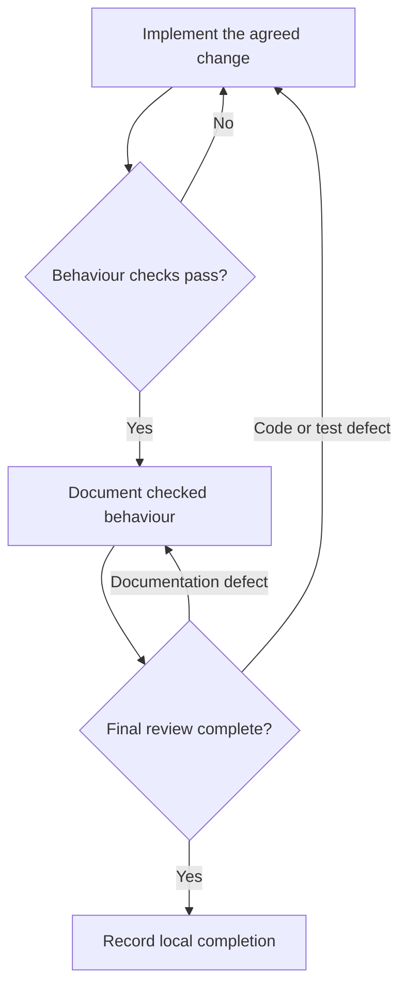

# Progression Guide 4: Break a larger job into clear, checkable tasks

A practical guide to dividing an application change into stages that have clear boundaries, usable inputs, observable results, and reasons to stop.

This guide follows [Guide 1: Connect your assistant to useful tools and information with MCP](AI-Progression-Guide-01-MCP.md), [Guide 2: Control what connected tools can read and change](AI-Progression-Guide-02-Tool-Permissions.md), and [Guide 3: Combine skills with connected tools](AI-Progression-Guide-03-Skills-and-Tools.md). It continues the progression series; it does not replace Example 4 in the original collection.

**Documentation checked and example prepared: 11 October 2026.** Product controls can change. Official references appear where relevant and at the end.

## What you will learn

By completing this guide, you will be able to:

- Turn one larger objective into smaller tasks with clear results.

- State what each task may change and what it must preserve.

- Identify dependencies: the decisions or results that must exist before another task starts.

- Supply the files and evidence needed for the current stage.

- Define expected outputs and checks before asking for implementation.

- Distinguish finishing a stage from being unable to continue.

- Keep a record of actual progress, evidence, blockers, and rework.

- Return to an earlier task when testing or review finds a problem.

- Repeat checks when later changes make their earlier results outdated.

- Complete the stages with one assistant before considering multiple agents.

The worked example changes a small **command-line application**: a program you run by typing a command in a terminal. It currently displays three fictional tasks. You will ask your assistant to add a way to show only open tasks or only completed tasks, while preserving the existing display of all tasks.

The change is small enough to inspect, but it includes the same four kinds of work found in many larger jobs: **implementation, testing, documentation, and final review**. The aim is to practise organising the work, rather than to build an elaborate application.

You will use one assistant conversation for the stages. You will not create a controller, delegate work, or install an MCP server. The sample uses only Node.js built-in features and local files.

## Reading route

1. Read the planning terms and the four-task overview.

2. Create the supplied application and planning files.

3. Check the starting behaviour and preserve a baseline.

4. Ask your assistant to prepare a plan without implementing it.

5. Complete implementation, testing, documentation, and final review in order.

6. Practise a failed check and a missing-input stopping condition.

7. Review the evidence and adapt the task template to your own work.

The numbered **Steps** below tell you what to do. The **TASK-1** to **TASK-4** labels identify the assistant's four planned work stages. They are separate numbering systems: for example, Step 7 asks the assistant to carry out TASK-1.

## What a checkable task contains

“Add filtering” describes an objective. A useful task also says what information is available, what may change, how to check the result, and what should happen if something prevents completion.

| Planning term | Meaning in ordinary language | Example here |
| --- | --- | --- |
| Objective | The useful result you want overall | Display tasks by status |
| Boundary | What this task includes and excludes | Change filtering; do not add task editing |
| Dependency | Something that must be ready before the task can proceed | Testing needs the implemented filter |
| Required input | A file, decision, or earlier result needed for the work | Current application and agreed change request |
| Expected output | The thing the task must produce | Updated application and a short evidence record |
| Check | An action that can establish whether a requirement is met | Run the open filter and inspect the returned task IDs |
| Completion condition | The evidence needed to call this task done | Required outputs exist and its checks pass |
| Stopping condition | A reason to pause before continuing | A required file is missing or a check fails |
| Handoff | What the next task receives | Changed files, check results, and remaining limits |

A task should have a result that you can inspect. “Work on the application” is too vague. “Add the two agreed filters in `app.mjs`, preserve the original output, and demonstrate the three commands” gives the assistant a clear job.

### Two different reasons to stop

| Reason | What the assistant reports | What happens next |
| --- | --- | --- |
| The requested stage is complete | What changed, which checks ran, their results, and any limits | Stop at the teaching checkpoint; you inspect it before sending the next stage prompt |
| The stage cannot be completed as specified | What is missing or failing, what was attempted, and which later tasks are affected | Mark it BLOCKED; resolve that specific problem before continuing |

The checkpoints in this tutorial are deliberate learning pauses. They are separate from a host's permission or command-approval controls. In your own routine work, you can authorise an assistant to continue through an agreed plan, stopping only for genuine blockers.

### Keep the tasks large enough to be useful

Do not create a separate task for every line of code or every file read. A good task groups related work into one inspectable result. Separate tasks when the required inputs, permitted changes, responsibility, or completion evidence differ.

Testing starts with a written set of expectations, even though the task that expands and runs the tests comes after implementation. Defining the test cases in the plan prevents the new code from becoming the only source of its own expected behaviour.

### The four tasks in this example

| Task | Needed before it starts | May change during this task | Output |
| --- | --- | --- | --- |
| TASK-1 — Implementation | Agreed request, inspected starting files, and passing baseline checks | `app.mjs`, `tasks/work-plan.md` | Working filters and initial checks |
| TASK-2 — Testing | TASK-1 completion evidence and current application | `app.test.mjs`, `tasks/work-plan.md` | Tests mapped to requirements, results, and gaps |
| TASK-3 — Documentation | TASK-2 passes on the current application and no unresolved behaviour defect | `README.md`, `tasks/work-plan.md` | Instructions matching the implemented behaviour |
| TASK-4 — Final review | Current implementation, passing test evidence, current README, and scope results | `tasks/final-review.md`, `tasks/work-plan.md` | Requirement-by-requirement review and a justified verdict |

In a real project, some drafting could happen earlier or in parallel. Here, the order makes dependencies and handoffs easy to observe. It also prevents the finished README from describing a feature that has not passed its checks.

### What happens when a later task finds a defect

**EXPLANATION ONLY — this diagram is not a command**



When implementation changes, test results for the older version need to be repeated. Documentation must be rechecked if the behaviour it describes changes. Final review must then use the current files and current evidence. Do not leave downstream tasks marked DONE just because they were done for an earlier version.

## Which files do what

`AGENTS.md` holds the standing instructions for this practice project. Codex can discover project instructions under that name. `.github/copilot-instructions.md` is Copilot's project instruction file; this example uses it to point to the shared rules. [OpenAI project instructions](https://learn.chatgpt.com/docs/agent-configuration/agents-md) · [Microsoft project instructions](https://code.visualstudio.com/docs/agents/guides/customize-copilot-guide)

`docs/change-request.md` defines the particular change. `tasks/work-plan.md` records the plan and its changing status. The two templates give you reusable layouts. These are ordinary Markdown documents, not automatically executed configuration files. The instructions and prompts explicitly tell the assistant to read them.

There is no universal task-plan filename or schema that all assistants automatically recognise. `work-plan.md` is the name chosen for this exercise. You do not need `SKILL.md` to organise a single change. If this method becomes a procedure you frequently repeat, you can later package the planning procedure and templates as a skill, using what you learned in Guide 3.

Written file boundaries guide behaviour. They do not prevent an assistant with file access from changing other files. The supplied scope checker detects selected changes afterwards; host permissions determine what actions are actually available.

## Choose one assistant route

| Route | Where the files are | Who edits and runs checks |
| --- | --- | --- |
| A — Codex in VS Code | Your open local practice folder | Codex can edit and run available local tools; you inspect and repeat the stated checks |
| B — GitHub Copilot in VS Code | Your open local practice folder | A local Copilot session can edit and run enabled tools; you inspect and repeat the stated checks |
| C — ChatGPT or ChatGPT Work with attachments | Copies you attach or paste into the conversation | The assistant returns file contents; you save them and run the local checks |

Use only one route for the exercise. Keep the same assistant conversation through the four stages unless a session limitation requires restarting.

If ChatGPT Work has authorised local access to this exact folder, you can use its available local file and terminal tools. Check that access explicitly. Browser uploads alone do not establish access to your computer, and tests run in another environment do not verify your local files. [ChatGPT Work setup](https://learn.chatgpt.com/docs/get-started-with-work)

The attachment route deliberately works without MCP or a locally installed skill. The files and procedure are supplied as task context.

## How to read the instructions

| Label | What you do |
| --- | --- |
| **YOU — in VS Code** | Create, inspect, edit, or save the stated file |
| **YOU — in the terminal** | Paste the command into the project terminal and press Enter or Return |
| **YOU — in the AI chat** | Send the supplied prompt to the chosen assistant |
| **EXPECTED ON SCREEN** | Compare it with what you see; do not type it |
| **AI — expected response** | Inspect the assistant's answer against the stated conditions |
| **EXPLANATION ONLY** | Read it; no command or prompt is required |

Copy only the contents of a code box, without the surrounding backticks. Save files with Ctrl+S on Linux or Command+S on Mac. Run terminal commands separately. Right-click inside the terminal and choose Paste if its keyboard shortcuts differ from your editor's.

When this guide says to run `echo $?`, run it **immediately after the preceding command**, before any other command. It prints that preceding command's exit code. Code `0` means success; a nonzero code means a failure or refusal. Some deliberately invalid application commands should return `1`.

Output redirected with `>` is saved to the named file rather than displayed. `2>&1` saves error output in that same file. The later `cat` command displays the saved text. These are commands for your terminal, not prompts for the assistant.

## Before you start

The practice files are intended for Ubuntu 22.04, 24.04, and 26.04; Kubuntu 26.04; and supported macOS installations on Intel and Apple Silicon Macs, including M4/M5 machines. Check that your installed software supports your actual operating-system version.

You need VS Code, access to one assistant route, and **Node.js 24**. This exercise does not use npm packages, credentials, a database, or an external service. Do not run `npm install` for it.

**YOU — in VS Code**

Choose **Terminal → New Terminal**.

**YOU — in the terminal**

Run:

```bash
node --version
```

**EXPECTED ON SCREEN**

A version beginning with `v24.`.

If you installed the separate Node copy described in Guide 1 and this terminal cannot find it, run:

```bash
export PATH="$HOME/usr/local/node-mcp-training/bin:$PATH"
```

Then repeat the version check. Repeat that PATH step in any new terminal that needs it. If Node 24 is not installed, use **Preparation B** in [Guide 1](AI-Progression-Guide-01-MCP.md) or the official download instructions at <https://nodejs.org/en/download>.

Stop any practice services left running from earlier guides. This example does not need their tools or connections.

## Step 1 — Create the practice project

**YOU — in the terminal**

Run:

```bash
mkdir -p "$HOME/ai-examples"
```

Then:

```bash
mkdir "$HOME/ai-examples/ai-progression-04"
```

If the second command reports that the folder already exists, inspect it before continuing. Resume a recognised copy of this exercise or preserve the existing folder under another name. Do not overwrite unrelated files.

**YOU — in VS Code**

Choose **File → Open Folder** and open `ai-examples/ai-progression-04` inside your Home folder. Check the selected folder before accepting any project-trust request.

Open a terminal in that project window and run:

```bash
cd "$HOME/ai-examples/ai-progression-04"
```

Then:

```bash
pwd
```

**EXPECTED ON SCREEN**

The path ends with `/ai-examples/ai-progression-04`. On Linux it normally begins with `/home/your-name`; on Mac it normally begins with `/Users/your-name`.

Keep this guide document outside the practice project. The scope checker should inspect the exercise files, not a downloaded copy of the tutorial itself.

### How the files relate

All paths below are relative to `ai-progression-04/`.

| Path | Purpose | Created by |
| --- | --- | --- |
| `app.mjs` | The application that will change | You; later updated by the assistant |
| `app.test.mjs` | The five starting tests; later extended | You; later updated by the assistant |
| `data/tasks.json` | The fictional task collection | You; then kept unchanged |
| `README.md` | How a person uses the application | You; later updated by the assistant |
| `AGENTS.md` | Shared project instructions and stage boundaries | You |
| `.github/copilot-instructions.md` | Copilot's pointer to those instructions | You |
| `docs/change-request.md` | The agreed requirements, numbered R1-R10 | You |
| `tasks/task-template.md` | Reusable fields for each planned task | You |
| `tasks/work-plan.md` | The four-task plan, status, and evidence history | You; later updated by the assistant |
| `tasks/review-template.md` | Layout for the final review | You |
| `tools/check-scope.mjs` | Preserves a baseline and checks permitted cumulative file changes | You |
| `observations.md` | Your own findings | You |
| `.gitignore` | Excludes generated evidence and baseline copies from normal Git additions | You |
| `baseline/files/` and `baseline/manifest.json` | Copies and hashes of the starting files | The snapshot command |
| `evidence/` | Saved terminal results | You |
| `tasks/final-review.md` | The final review output | The assistant, or you saving its attachment-route answer |

The application, test file, and data are the working software. The request and plan describe the change. The baseline and evidence let you compare results without trusting the assistant's summary alone.

## Step 2 — Create the starting application

**YOU — in VS Code**

Create a folder named `data` inside the project, using the Explorer panel's **New Folder** button. Create the following four files in their stated locations.

### `app.mjs`

The starting application displays every task and refuses extra arguments. Its exported `run` function is also used by the tests. `.mjs` tells Node that this is a JavaScript module. You do not need to understand every line before practising the planning method.

**YOU — in VS Code**

Create `app.mjs` inside the practice project. Copy the complete contents below into it and save it.

```javascript
import { readFileSync } from 'node:fs';
import { resolve } from 'node:path';
import { fileURLToPath } from 'node:url';

export function run(args, tasks) {
  if (args.length !== 0) throw new Error('Usage: node app.mjs');
  if (tasks.length === 0) return 'No tasks.';
  return tasks.map(task => `[${task.status}] ${task.id}: ${task.title}`).join('\n');
}

if (process.argv[1] && resolve(process.argv[1]) === fileURLToPath(import.meta.url)) {
  try {
    const tasks = JSON.parse(readFileSync(new URL('./data/tasks.json', import.meta.url), 'utf8'));
    console.log(run(process.argv.slice(2), tasks));
  } catch (error) {
    console.error('Error: ' + error.message);
    process.exitCode = 1;
  }
}
```

### `data/tasks.json`

JSON is a structured text format. Each object below is one task with an ID, title, and status. `done` means completed. The filter must select existing records without rewriting them.

**YOU — in VS Code**

Create `data/tasks.json` inside the practice project. Copy the complete contents below into it and save it.

```json
[
  { "id": 1, "title": "Write the meeting notes", "status": "open" },
  { "id": 2, "title": "Check the backup record", "status": "done" },
  { "id": 3, "title": "Prepare the shopping list", "status": "open" }
]
```

### `app.test.mjs`

These five tests describe the existing behaviour. The later testing task will keep them and add checks for the agreed change. The tests also launch the real application as a separate process.

**YOU — in VS Code**

Create `app.test.mjs` inside the practice project. Copy the complete contents below into it and save it.

```javascript
import test from 'node:test';
import assert from 'node:assert/strict';
import { spawnSync } from 'node:child_process';
import { readFileSync } from 'node:fs';
import { fileURLToPath } from 'node:url';
import { run } from './app.mjs';

const dataPath = new URL('./data/tasks.json', import.meta.url);
const tasks = JSON.parse(readFileSync(dataPath, 'utf8'));
const expected = '[open] 1: Write the meeting notes\n[done] 2: Check the backup record\n[open] 3: Prepare the shopping list';
const appPath = fileURLToPath(new URL('./app.mjs', import.meta.url));

test('no arguments show every task in its original order', () => {
  assert.equal(run([], tasks), expected);
});

test('an empty collection has a clear message', () => {
  assert.equal(run([], []), 'No tasks.');
});

test('unknown arguments are refused', () => {
  assert.throws(() => run(['--unknown'], tasks), /Usage: node app\.mjs/);
});

test('the command-line application prints the original list', () => {
  const result = spawnSync(process.execPath, [appPath], { encoding: 'utf8' });
  assert.ifError(result.error);
  assert.equal(result.status, 0);
  assert.equal(result.stdout, expected + '\n');
  assert.equal(result.stderr, '');
});

test('listing does not change the data file', () => {
  const before = readFileSync(dataPath);
  const result = spawnSync(process.execPath, [appPath], { encoding: 'utf8' });
  assert.ifError(result.error);
  assert.equal(result.status, 0);
  assert.deepEqual(readFileSync(dataPath), before);
});
```

### `README.md`

This starting README describes the application before filtering exists. The documentation task will update it after the changed behaviour has passed its checks.

**YOU — in VS Code**

Create `README.md` inside the practice project. Copy the complete contents below into it and save it.

````markdown
# Practice task list

This small command-line application displays fictional tasks from
`data/tasks.json`. It needs Node.js 24 and has no third-party dependencies.

## Show the tasks

Open a terminal in this project folder and run:

```bash
node app.mjs
```

Expected output:

```text
[open] 1: Write the meeting notes
[done] 2: Check the backup record
[open] 3: Prepare the shopping list
```

The application displays the stored list; it does not edit it.
This starting version does not support filtering.

## Run the existing checks

```bash
node --test app.test.mjs
```

The starting suite contains five tests. These checks cover the supplied
behaviour and sample data, not every possible application requirement.
````

## Step 3 — Create the request, instructions, templates, and checker

**YOU — in VS Code**

Create these folders directly inside the project: `.github`, `docs`, `tasks`, and `tools`. The dot at the start of `.github` is intentional. Create the files below in their stated locations.

The request is already complete for this practice change. You will ask the assistant to break it into tasks, rather than ask it to invent product requirements.

### `docs/change-request.md`

The R1-R10 identifiers give you a stable way to connect requirements, tests, documentation, and review findings. A table cell containing a vertical bar uses `\|` so that Markdown does not mistake it for another column.

**YOU — in VS Code**

Create `docs/change-request.md` inside the practice project. Copy the complete contents below into it and save it.

````markdown
# Change request: display tasks by status

## Objective

Let a person display only open tasks or only completed tasks in this local
practice task-list application. Keep the existing display of all tasks.

## Requirements

| ID | Required behaviour | Observable result |
| --- | --- | --- |
| R1 | No arguments retain the current output | Tasks 1, 2, and 3 appear in that order with their existing text |
| R2 | --status open selects open tasks | Tasks 1 and 3 appear; task 2 does not |
| R3 | --status done selects completed tasks | Only task 2 appears |
| R4 | Preserve the selected tasks' original order and line format | Each line remains [status] id: title; no sorting or renumbering |
| R5 | An empty result is explicit | No tasks. for an empty unfiltered collection; No open tasks. or No done tasks. for an empty filtered result |
| R6 | Accept only the exact new argument form | Exactly --status followed by lowercase open or done; any other nonempty argument list fails |
| R7 | Invalid arguments fail without printing task results | Exit code 1; no stdout; one stderr line: Error: Usage: node app.mjs [--status open\|done] |
| R8 | Listing is read-only | No changes to data/tasks.json or the supplied array; no external request or package installation |
| R9 | Test old and new behaviour | Keep the five starting tests; cover both filters, empty results, order, invalid forms, CLI exits, and unchanged data |
| R10 | Document what the program actually does | README gives all three commands, exact sample results, empty-result and invalid-argument behaviour, read-only scope, and the test command |

The backslash before the vertical bar in the table is Markdown escaping.
The actual usage text is:

```text
Usage: node app.mjs [--status open|done]
```

For R6, invalid examples include --status without a value, --status closed,
--status OPEN, --status=open, a repeated --status pair, and --unknown.
Do not invent --help or --status all support.

## Work boundaries

Change only app.mjs, app.test.mjs, README.md, tasks/work-plan.md, and the new
tasks/final-review.md, in the appropriate stage. The human creates evidence
files and may update observations.md. Do not alter this request or sample data.
Do not add task creation, editing, deletion, persistence, a web interface,
authentication, a database, dependencies, or deployment.

## Inputs

The starting application, its five tests, the sample data, this request,
the task template, project instructions, and the human's baseline results.
No business decision is left open in the supplied request.

## Overall completion

Implementation, tests, and README agree with R1-R10. Required checks pass on
the current files. The scope check passes. Final review accounts for every
requirement, identifies evidence and limitations, and has no unresolved blocker.
Completion means a reviewed local practice change, not a release or deployment.
````

### `AGENTS.md`

The standing rules tell the assistant to complete only the requested stage, preserve the supplied inputs, and report actual evidence. These are instructions, not enforced filesystem permissions.

**YOU — in VS Code**

Create `AGENTS.md` inside the practice project. Copy the complete contents below into it and save it.

```markdown
# Guide 4 practice project

Work with one assistant in this project. Do not delegate, create subagents,
start background tasks, or use external services. No MCP connection is needed.

Read docs/change-request.md and tasks/work-plan.md before each stage.
Read tasks/task-template.md when preparing or revising the plan.
The human sends a separate prompt for each stage. Complete only the requested
stage and stop at its stated checkpoint. A task list is not permission to
execute all later tasks.

During planning, edit only tasks/work-plan.md.
During implementation, edit only app.mjs and tasks/work-plan.md.
During testing, edit only app.test.mjs and tasks/work-plan.md.
During documentation, edit only README.md and tasks/work-plan.md.
During final review, edit only tasks/final-review.md and tasks/work-plan.md.

The human creates the baseline, saves terminal evidence, and updates
observations.md. Do not edit baseline/, evidence/, data/tasks.json,
docs/change-request.md, instruction files, templates, or tools/check-scope.mjs.
Do not install packages, change Node, publish, commit, or deploy anything.
You may read baseline copies and evidence when the human supplies them.

Available local checks are node --check app.mjs, node --test app.test.mjs,
and the application commands specified in the change request.
Use only local file-reading, editing, and terminal tools needed for this stage.
An unavailable tool is a blocker or a reason to report a check as not run.

Use the requirement IDs when describing tests and findings. Preserve useful
existing tests. Do not change a requirement or weaken a test to obtain a pass.
If implementation fails during testing, record the failure and stop; return
to implementation only when the human requests that stage.

Record actual evidence, who ran it, and the current file versions it covers.
Distinguish planned checks, assistant-run checks, and human-run checks.
Mark a stage DONE only when its completion conditions are supported.
Use BLOCKED for missing inputs, failed required checks, or unresolved choices.
Never mark an unrun required check as passed.

After a change, invalidate downstream evidence that depended on the old files.
Keep a brief history in tasks/work-plan.md rather than erasing earlier failures.
Final review is a fresh pass by the same assistant, not an independent audit.
```

### `.github/copilot-instructions.md`

This gives Copilot a project instruction file that points to the same rules. Create it even if you choose another route, so the example remains usable with either assistant later.

**YOU — in VS Code**

Create `.github/copilot-instructions.md` inside the practice project. Copy the complete contents below into it and save it.

```markdown
# Guide 4 practice instructions

Read and follow AGENTS.md at the project root. Use one assistant and complete
only the stage requested in the current prompt. Read docs/change-request.md
and tasks/work-plan.md. Stay within that stage's file list, record observed
evidence, and stop at its checkpoint. Do not use subagents or external tools.
```

### `tasks/task-template.md`

This reusable layout makes missing task details visible. The assistant will use it to write each of the four tasks into the work plan.

**YOU — in VS Code**

Create `tasks/task-template.md` inside the practice project. Copy the complete contents below into it and save it.

```markdown
# Template for one checkable task

Copy the fields below into work-plan.md for each task. Replace every placeholder.
These are planning fields, not automatically interpreted configuration keys.

## TASK-ID — Short task title

Status: NOT_STARTED

Depends on: requirement or task IDs, and what evidence is required

Goal: the one result this task must produce

Required inputs: exact files, decisions, and earlier outputs

May change: exact file paths

Must preserve: relevant behaviour, data, and other boundaries

Expected outputs: changed files and a brief result record

Checks: specific commands or reading checks, with expected results

Done when: observable conditions that permit this task to be marked DONE

Stop if: missing inputs, failed checks, ambiguity, or a need to exceed scope

Next handoff: what the following task needs from this one

Evidence: initially "not run"; later record actual runner, result, and scope

Use NOT_STARTED, RUNNING, DONE, or BLOCKED. Keep failed or superseded results
in a short history. DONE means the evidence supports the task's own completion
conditions; it does not imply the entire change is complete.
```

### `tasks/work-plan.md`

This is a placeholder, not a finished plan. The planning prompt will replace its placeholder sections while leaving application files unchanged.

**YOU — in VS Code**

Create `tasks/work-plan.md` inside the practice project. Copy the complete contents below into it and save it.

```markdown
# Task-status filter work plan

Plan state: NOT_PLANNED

Overall result: NOT_COMPLETE

The planning prompt will replace this placeholder with four tasks:
TASK-1 implementation, TASK-2 testing, TASK-3 documentation, TASK-4 final review.
Use tasks/task-template.md. Do not execute the tasks during planning.

## Requirement coverage

Not yet mapped.

## Evidence and history

No assistant stage has run. The human will supply baseline checks.
```

### `tasks/review-template.md`

Final review needs a verdict backed by requirement coverage and current evidence. This file is a template; it must not be presented as a completed review.

**YOU — in VS Code**

Create `tasks/review-template.md` inside the practice project. Copy the complete contents below into it and save it.

```markdown
# Final review: task-status filter

Verdict: NOT_REVIEWED

Use COMPLETE, INCOMPLETE, or BLOCKED after reading the current files and evidence.

## Files and evidence inspected

List current files, checks, their runner, and results. Identify anything unavailable.

## Requirement coverage

| Requirement | Current implementation or documentation | Evidence | Result |
| --- | --- | --- | --- |
| R1 | | | |
| R2 | | | |
| R3 | | | |
| R4 | | | |
| R5 | | | |
| R6 | | | |
| R7 | | | |
| R8 | | | |
| R9 | | | |
| R10 | | | |

## Findings

Describe unresolved defects or say none were found within the checks performed.
Do not silently edit application, tests, data, or README during review.

## Evidence that must be repeated

Name outdated checks or explain why supplied results still apply to current files.

## Limits

This is a review by the same assistant that completed earlier stages.
It is not an independent security audit, a production release, or proof of
compatibility with every operating system and processor.

## Next action

State completion or the exact task to reopen and its reason.
```

### `tools/check-scope.mjs`

This human-operated checker copies the starting files once and records their SHA-256 hashes, which are fingerprints of their bytes. Later, it compares the working project with that baseline. It refuses to replace an existing baseline.

**YOU — in VS Code**

Create `tools/check-scope.mjs` inside the practice project. Copy the complete contents below into it and save it.

```javascript
import { createHash } from 'node:crypto';
import { existsSync, mkdirSync, readFileSync, readdirSync, writeFileSync } from 'node:fs';
import { dirname, join } from 'node:path';
import { fileURLToPath } from 'node:url';

const root = dirname(dirname(fileURLToPath(import.meta.url)));
const baseline = join(root, 'baseline');
const stage = process.argv[2];
const lists = {
  plan: ['tasks/work-plan.md'],
  implementation: ['tasks/work-plan.md', 'app.mjs'],
  testing: ['tasks/work-plan.md', 'app.mjs', 'app.test.mjs'],
  documentation: ['tasks/work-plan.md', 'app.mjs', 'app.test.mjs', 'README.md'],
  review: ['tasks/work-plan.md', 'app.mjs', 'app.test.mjs', 'README.md', 'tasks/final-review.md']
};
const hash = bytes => createHash('sha256').update(bytes).digest('hex');

function scan(directory = root, prefix = '') {
  const result = {};
  for (const entry of readdirSync(directory, { withFileTypes: true })) {
    const path = prefix ? prefix + '/' + entry.name : entry.name;
    if (entry.name === '.DS_Store' || path === 'baseline' || path === 'evidence'
        || path === '.git' || path === 'observations.md') continue;
    if (entry.isSymbolicLink()) throw new Error('Unexpected symbolic link: ' + path);
    if (entry.isDirectory()) Object.assign(result, scan(join(directory, entry.name), path));
    else if (entry.isFile()) result[path] = hash(readFileSync(join(directory, entry.name)));
    else throw new Error('Unexpected file type: ' + path);
  }
  return result;
}

try {
  if (process.argv.length !== 3) throw new Error('Supply exactly one stage or snapshot.');
  if (stage === 'snapshot') {
    if (existsSync(baseline)) throw new Error('baseline already exists; it was not replaced.');
    const files = scan();
    mkdirSync(join(baseline, 'files'), { recursive: true });
    for (const path of Object.keys(files)) {
      const target = join(baseline, 'files', path);
      mkdirSync(dirname(target), { recursive: true });
      writeFileSync(target, readFileSync(join(root, path)));
    }
    writeFileSync(join(baseline, 'manifest.json'), JSON.stringify(files, null, 2) + '\n');
    console.log('SAVED: baseline copy of ' + Object.keys(files).length + ' starting files.');
  } else {
    if (!Object.hasOwn(lists, stage)) throw new Error('Choose snapshot, plan, implementation, testing, documentation, or review.');
    const original = JSON.parse(readFileSync(join(baseline, 'manifest.json'), 'utf8'));
    const current = scan();
    let failed = false;
    let changes = 0;
    for (const path of [...new Set([...Object.keys(original), ...Object.keys(current)])].sort()) {
      if (original[path] === current[path]) continue;
      changes += 1;
      if (!Object.hasOwn(current, path)) {
        console.log('FAIL: missing starting file: ' + path);
        failed = true;
      } else if (!lists[stage].includes(path)) {
        console.log('FAIL: out-of-scope change or new file: ' + path);
        failed = true;
      } else console.log('CHANGED: ' + path);
    }
    if (failed) process.exitCode = 1;
    else {
      if (changes === 0) console.log('NO CHANGES: files match the baseline.');
      console.log('PASS: changes are within the cumulative ' + stage + ' file list.');
    }
  }
} catch (error) {
  console.error('FAIL: ' + error.message);
  process.exitCode = 1;
}
```

### Understand the checker before relying on it

Each stage's scope check is **cumulative from the starting baseline**. For example, documentation allows the already changed application and tests, plus the README and work plan. It does not establish which stage made a particular edit. You still inspect the changes made during the current stage.

The checker ignores `baseline/`, `evidence/`, `.git/`, `observations.md`, and `.DS_Store`. It reports an unexpected file or a protected-file change, and it rejects deletion of a starting file. It does not decide whether an allowed code change is correct or whether a test result belongs to the latest version.

This is a local comparison aid. The baseline and checker are ordinary writable files, so they are not a tamper-resistant audit system or a permission boundary. Do not let the assistant edit them or replace the baseline after a change to hide a scope failure.

### `observations.md`

Keep your own account of what happened. Use “not tested” where appropriate. The assistant does not fill this sheet for you.

**YOU — in VS Code**

Create `observations.md` inside the practice project. Copy the complete contents below into it and save it.

```markdown
# My task-decomposition exercise

Date:

Operating system and processor:

Node version:

Assistant route, application version, and model:

Local execution or attachment-based route:

| Checkpoint | My observed result and evidence |
| --- | --- |
| Baseline application and five tests | |
| Four-task plan with complete fields | |
| Assistant stopped after planning | |
| Implementation preserved all-task output | |
| Both filters returned the expected tasks | |
| Missing and invalid arguments failed correctly | |
| Testing covered requirements rather than copying code | |
| Test suite detected the deliberate defect | |
| Data and protected files stayed unchanged | |
| README matched current behaviour | |
| Final review used current evidence | |
| Missing-input exercise stopped at the blocker | |

Actual test count:

Checks run by me:

Checks run by the assistant:

Checks not run:

Unexpected or out-of-scope changes:

Rework and evidence repeated:

What I would improve in the next task plan:
```

### `.gitignore`

Git is optional for this tutorial. If you later use it, this file keeps generated baseline copies and evidence out of ordinary additions. It does not hide files from the assistant or enforce the task boundaries.

**YOU — in VS Code**

Create `.gitignore` inside the practice project. Copy the complete contents below into it and save it.

```gitignore
baseline/
evidence/
.DS_Store
```

## Step 4 — Check the starting version and preserve it

Complete this step before sending an implementation prompt.

**YOU — in the terminal**

Run:

```bash
mkdir -p evidence
```

Then:

```bash
node app.mjs
```

**EXPECTED ON SCREEN**

```text
[open] 1: Write the meeting notes
[done] 2: Check the backup record
[open] 3: Prepare the shopping list
```

**YOU — in the terminal**

Run:

```bash
node --test app.test.mjs > evidence/01-baseline-tests.txt 2>&1
```

Immediately run:

```bash
echo $?
```

**EXPECTED ON SCREEN**

`0`.

**YOU — in the terminal**

Run:

```bash
cat evidence/01-baseline-tests.txt
```

**EXPECTED ON SCREEN**

The summary reports **5 tests, 5 passes, and 0 failures**. There should also be zero cancelled, skipped, and pending (`todo`) tests. Symbols, timings, and layout may differ; compare the counts and results rather than exact decoration.

If the application output differs or a starting test fails, stop here. Compare your copied files with Step 2. Do not begin a change on an unexplained failing baseline.

**YOU — in the terminal**

After those checks pass, run:

```bash
node tools/check-scope.mjs snapshot
```

**EXPECTED ON SCREEN**

```text
SAVED: baseline copy of 12 starting files.
```

There are 13 files you created; `observations.md` is deliberately excluded. The generated evidence is also excluded. If the count differs, inspect the extra or missing files before proceeding.

**YOU — in the terminal**

Run:

```bash
node tools/check-scope.mjs plan > evidence/01-baseline-scope.txt 2>&1
```

Immediately run:

```bash
echo $?
```

Expect `0`. Then run:

```bash
cat evidence/01-baseline-scope.txt
```

**EXPECTED ON SCREEN**

```text
NO CHANGES: files match the baseline.
PASS: changes are within the cumulative plan file list.
```

**YOU — in VS Code**

Open `observations.md` and record the actual baseline results, your Node version, and any copying problem you corrected. Save the file.

## Step 5 — Prepare your chosen assistant

Use a conversation for this practice project, with the following stage prompts. Do not ask a second assistant to take over a stage during this exercise.

### Route A — Codex in VS Code

**YOU — in VS Code and Codex**

1. Open the Codex panel and start a fresh **local** conversation for `ai-progression-04`.

2. Confirm that the session uses the practice folder you opened. If it uses a separate worktree or cloud checkout, switch to the local practice folder for this walkthrough.

3. Use permissions appropriate to reading and editing these practice files and running local Node commands. Review any requested action against the current stage. Do not broaden access merely because a check is unavailable.

4. Keep external connectors and delegated work out of this exercise. The prompts explicitly request one assistant.

Codex can use project `AGENTS.md` instructions. You will still name the request and plan in every stage prompt so that task-specific context is explicit. [OpenAI project instructions](https://learn.chatgpt.com/docs/agent-configuration/agents-md)

### Route B — GitHub Copilot in VS Code

**YOU — in VS Code and Copilot**

1. Open a new local Copilot chat for this practice folder. Select the Copilot harness or agent mode that can edit files and use local tools.

2. If the interface offers folder or worktree isolation, choose the folder session that uses this exact practice project.

3. Confirm that `.github/copilot-instructions.md` is available. The first prompt will also ask Copilot to read `AGENTS.md` explicitly.

4. Enable only the local file and terminal tools required for the exercise. Review requested actions against the current stage. Do not use subagents or external connections.

VS Code's model choice and its selected agent harness are separate settings. Select the Copilot route deliberately; a model name alone does not identify which project instruction format is used. [Microsoft agent overview](https://code.visualstudio.com/docs/agents/overview)

### Route C — ChatGPT or ChatGPT Work with attachments

**YOU — in the ChatGPT conversation**

Start a conversation and attach the current copies of these files:

- `AGENTS.md`

- `docs/change-request.md`

- `tasks/task-template.md`

- `tasks/work-plan.md`

- `app.mjs`

- `app.test.mjs`

- `data/tasks.json`

- `README.md`

- `evidence/01-baseline-tests.txt`

- `evidence/01-baseline-scope.txt`

If attachments do not retain their folders, include a message mapping each filename to the path above. If a file cannot be attached, paste its complete contents into a code block and label its full project-relative path. Do not paste this entire guide in place of the actual working files: it includes reference answers as well as starting files.

Send this route instruction once before the planning prompt:

```text
I am using the attachment-based route for Progression Guide 4.
You cannot assume access to my local practice folder or terminal.
Use the supplied current files and follow AGENTS.md explicitly.

For an authorised file change, return the complete contents of each changed
file in its own code block, labelled with its project-relative path.
I will save those files in VS Code and run the commands locally.
Do not claim you edited my local files or ran my local checks.
If you run a check in your own environment, identify that environment and
keep its result separate from the local results I provide.

When a task requires checks that have not been supplied, say "not run"
and leave it waiting for verification. Do not mark it DONE until its
required completion evidence is available.
Use one assistant and do not delegate any stage.
```

After each stage, save its returned file contents to the stated paths. Replace only the files authorised for that stage. Before the next stage, attach the updated files and relevant evidence. Say that these current copies replace earlier attachments.

If local file-reading or terminal tools are unavailable on Routes A or B, the same return-files-and-run-checks-yourself method can be used. Record who actually ran each check.

## Step 6 — Ask for the four-task plan

**YOU — in the AI chat**

Paste and send:

```text
Prepare the plan for Progression Guide 4. Do not implement the change yet.
Read AGENTS.md, docs/change-request.md, tasks/task-template.md,
tasks/work-plan.md, app.mjs, app.test.mjs, data/tasks.json, and README.md.
Read the supplied evidence/01-baseline-tests.txt and
evidence/01-baseline-scope.txt. Stop if a required input is unavailable.

Use one assistant. Do not delegate, start background work, run application
commands, install packages, or use external services during planning.

Write four tasks into tasks/work-plan.md:
TASK-1 implementation, TASK-2 testing, TASK-3 documentation,
and TASK-4 final review.

For every task, fill in all fields from tasks/task-template.md:
status, dependencies, goal, required inputs, permitted changes,
what to preserve, expected outputs, specific checks, completion conditions,
stopping conditions, handoff, and evidence.
Use NOT_STARTED for stages that have not run.
Map R1-R10 to the tasks and planned checks. Preserve the exact run(args, tasks)
export and its opening line so the supplied tests and defect exercise work.
Include how failed checks reopen earlier work and invalidate downstream results.

Edit only tasks/work-plan.md, or return its complete contents if this is
the attachment route. Record supplied human-run baseline evidence as such;
do not claim to have run it yourself. Stop after presenting the plan.
```

**AI — expected response**

A populated `tasks/work-plan.md` containing four tasks and all the requested fields. Application, test, and README files remain unchanged. The assistant reports that it has finished planning and stops.

The plan should identify the five existing tests as a baseline, not as proof of the new filters. TASK-2 should cover the two filters, empty results, order, invalid arguments, CLI output and exits, and unchanged data. TASK-4 should account for documentation as well as code.

**YOU — in VS Code**

Open the work plan, or save its returned contents for Route C. Check that:

- Every task has named input files and a specific result.

- Dependencies identify earlier evidence, not just an arbitrary number order.

- Each task's permitted edits match the four-task overview.

- Completion conditions are checkable and stopping conditions are explicit.

- R1-R10 are covered, with no added feature or invented product decision.

- No future stage or unrun check is marked DONE or passed.

If a field is missing, send a correction that names it and asks for only the work plan to be updated. Do not send the implementation prompt until the plan is usable.

**YOU — in the terminal**

Run:

```bash
node tools/check-scope.mjs plan
```

**EXPECTED ON SCREEN**

The changed-file line names only `tasks/work-plan.md`, followed by:

```text
PASS: changes are within the cumulative plan file list.
```

If another file changed, inspect it before proceeding. A scope check that passes with NO CHANGES does not prove that a useful plan was written; you must read the plan.

## Step 7 — Complete TASK-1: implementation

**YOU — in the AI chat**

Paste and send:

```text
The four-task plan is ready. Complete TASK-1 only.
Read the current AGENTS.md, docs/change-request.md, and tasks/work-plan.md.
Implement the agreed status filters in app.mjs, preserving the exported
run(args, tasks) function and its opening line exactly as supplied.

Change only app.mjs and tasks/work-plan.md. Do not change tests, sample data,
README, requirements, templates, instructions, or the baseline.
Use one assistant and no external services or packages.

Where local execution is available, run the syntax check, existing tests,
and the application checks named in TASK-1. Report actual commands and results.
If execution is unavailable, return the changed files and list the checks
waiting for me to run. Do not claim a pass without evidence.

Record progress and evidence in the work plan. Stop after TASK-1 and its
handoff; do not start TASK-2 or expand the tests yet.
```

**YOU — in VS Code**

Inspect the changed `app.mjs`. For Route C, save its returned contents and the updated work plan. Check that the sample JSON and the original test file were not edited.

**YOU — in the terminal**

Run:

```bash
node --check app.mjs
```

Immediately run:

```bash
echo $?
```

Expect `0`; a successful syntax check normally prints no application output. It checks parsing, not whether filtering works.

Run:

```bash
node --test app.test.mjs > evidence/02-existing-tests.txt 2>&1
```

Immediately run:

```bash
echo $?
```

Expect `0`. Then run:

```bash
cat evidence/02-existing-tests.txt
```

Expect the same five tests to pass. They check preserved behaviour; the expanded suite has not been written yet.

### Check the three successful commands

**YOU — in the terminal**

Run these separately:

```bash
node app.mjs
```

```bash
node app.mjs --status open > evidence/02-open.txt 2>&1
```

Immediately run `echo $?`; expect `0`. Then run:

```bash
cat evidence/02-open.txt
```

**EXPECTED ON SCREEN**

```text
[open] 1: Write the meeting notes
[open] 3: Prepare the shopping list
```

The first, unfiltered command still shows tasks 1, 2, and 3 exactly as before.

**YOU — in the terminal**

Run:

```bash
node app.mjs --status done > evidence/02-done.txt 2>&1
```

Immediately run `echo $?`; expect `0`. Then run:

```bash
cat evidence/02-done.txt
```

**EXPECTED ON SCREEN**

```text
[done] 2: Check the backup record
```

### Check refusals as well as successes

**YOU — in the terminal**

Run:

```bash
node app.mjs --status closed > evidence/02-invalid.txt 2>&1
```

Immediately run `echo $?`; expect `1`. Then run:

```bash
cat evidence/02-invalid.txt
```

Expect this error and no task lines:

```text
Error: Usage: node app.mjs [--status open|done]
```

Repeat with a missing value:

```bash
node app.mjs --status > evidence/02-missing.txt 2>&1
```

Immediately run `echo $?`; expect `1`. Then run:

```bash
cat evidence/02-missing.txt
```

Expect the same usage error and no task lines. These files combine stdout and stderr for reading; TASK-2 will test the two streams separately.

**YOU — in the terminal**

Run:

```bash
node tools/check-scope.mjs implementation
```

Expect a PASS, with changed-file lines limited to `app.mjs` and `tasks/work-plan.md`.

### Record the implementation checkpoint

**YOU — in the AI chat**

Provide the actual command results or attach the evidence files. For Route C, also provide the current application and work plan. Send:

```text
Use the current files and the local results I have supplied to finish the
TASK-1 evidence record. Identify my checks as human-run. Do not infer results
for any command I did not report. Mark TASK-1 DONE only if its completion
conditions are met; otherwise record the failure or missing check and stop.
Update only tasks/work-plan.md and stop before TASK-2.
```

If a check fails, keep TASK-1 unfinished. Give the assistant the exact command, output, and current file, and ask it to repair TASK-1 within the same edit boundaries. Repeat the affected checks before proceeding.

## Step 8 — Complete TASK-2: testing

**YOU — in the AI chat**

Paste and send:

```text
Complete TASK-2 only. Confirm that TASK-1's required checks support completion
on the current app.mjs. Read the change request, work plan, current application,
and current test file. Use one assistant.

Extend app.test.mjs while keeping the five existing tests.
Derive expected results from R1-R9, not just from the current code.
Cover both filters, both filtered empty-result messages, the original empty
message, a deliberately non-sorted input order, unchanged input records,
missing/unknown/uppercase values, the equals-sign form, repeated options,
unknown options, exact CLI usage error, exit codes, stdout/stderr separation,
and unchanged data after CLI filtering.

Change only app.test.mjs and tasks/work-plan.md. Do not fix app.mjs during
this task. If a test reveals a defect, record the requirement, expected and
actual results, mark testing BLOCKED, and identify TASK-1 as needing rework.
Do not weaken a test or alter a requirement to obtain a pass.

Run the suite if local execution is available. Otherwise return the complete
changed files for me to save and test. Report requirement coverage, actual
results, and gaps. Stop after TASK-2; do not begin documentation.
```

**YOU — in VS Code**

Inspect and save the updated test file and work plan. Verify that tests assert actual expected values. Merely calling a function without checking its result is insufficient.

Look for the five original tests and the new cases requested above. A different organisation or test count from the reference answer is acceptable if the coverage and assertions are sound.

**YOU — in the terminal**

Run:

```bash
node --test app.test.mjs > evidence/03-tests-before-defect.txt 2>&1
```

Immediately run `echo $?`; expect `0`. Then run:

```bash
cat evidence/03-tests-before-defect.txt
```

Expect every test to pass, with zero failed, cancelled, skipped, and pending tests. The supplied reference suite has **18 tests**. Do not treat a count of 18 by itself as proof of coverage.

Run:

```bash
node tools/check-scope.mjs testing
```

Expect PASS. The cumulative changed files may now include the application, test file, and work plan. This does not authorise the testing task to edit implementation itself.

If the suite fails, read the failing assertion. Send its command, output, and affected requirement to the assistant. A correct test exposing a code defect goes back to TASK-1; an incorrectly written test is corrected within TASK-2. The requirement remains the reference point.

## Step 9 — Prove the tests can detect a defect and practise rework

Do this before starting documentation. You will insert one temporary fault in the practice application, observe the failure, remove it, and restore passing evidence. Do not modify the real sample data.

**YOU — in VS Code**

Open `app.mjs`. Find this exact opening line:

```javascript
export function run(args, tasks) {
```

Immediately beneath it, insert this one line and save:

```javascript
  if (args.length === 2 && args[0] === '--status' && args[1] === 'open') return 'No open tasks.';
```

This deliberately lies about a valid open-task result. The rest of the file stays as it was. If your implementation did not preserve the stated opening line, stop and resolve that implementation difference before inserting anything.

**YOU — in the terminal**

Run:

```bash
node --test app.test.mjs > evidence/03-defect-tests.txt 2>&1
```

Immediately run `echo $?`; expect `1`. Then run:

```bash
cat evidence/03-defect-tests.txt
```

**EXPECTED ON SCREEN**

At least one test fails because open tasks were replaced by `No open tasks.`. With the reference suite, three tests fail: open selection, non-sorted input order, and CLI filtering.

If all tests pass, the suite missed this known defect. Do not continue. Ask the assistant to improve TASK-2's assertions against R2 and R4, leaving the temporary fault in place until a suitable test detects it.

**YOU — in the AI chat**

Supply the current application, tests, and actual failure output. Send:

```text
The application now contains the deliberate temporary fault from Step 9.
Read the supplied failing results and current files. Do not repair the code
or change tests in this response. Update only tasks/work-plan.md.

Record which requirement the failure demonstrates. Reopen TASK-1 as BLOCKED
and leave TASK-2 BLOCKED pending restoration and new checks. Keep the earlier
passing results as historical evidence, explicitly superseded by the current
failure. Keep TASK-3 and TASK-4 NOT_STARTED. Explain what evidence must be
repeated before documentation is allowed to begin. Stop here.
```

**AI — expected response**

An actual R2 failure is recorded, with any further affected cases. Later work remains unstarted. The assistant does not claim that the earlier passing test result still proves the changed file works.

### Remove only the temporary fault

**YOU — in VS Code**

In `app.mjs`, delete the one line you inserted:

```javascript
  if (args.length === 2 && args[0] === '--status' && args[1] === 'open') return 'No open tasks.';
```

Save the file. Do not restore the entire starting application: that would remove the filter feature too.

**YOU — in the terminal**

Run:

```bash
node --check app.mjs
```

Immediately run `echo $?`; expect `0`.

Then run:

```bash
node --test app.test.mjs > evidence/03-tests-restored.txt 2>&1
```

Immediately run `echo $?`; expect `0`. Then run:

```bash
cat evidence/03-tests-restored.txt
```

Expect every test to pass again. Also run:

```bash
node tools/check-scope.mjs testing
```

Expect PASS.

**YOU — in the AI chat**

Provide the restored current files and the new results. Send:

```text
I removed only the deliberate fault and supplied fresh checks for the restored
current files. Review this as the reopened TASK-1 implementation checkpoint,
then the TASK-2 testing checkpoint. Use one assistant; do not edit application,
tests, or README in this response.

Update only tasks/work-plan.md. Mark each task DONE only if the actual supplied
evidence satisfies its completion conditions. If another required check is
missing, name it and leave that task unfinished. Preserve the failure and
restoration history. Stop before TASK-3.
```

If the plan requires an additional manual command not covered by the supplied tests, run that command and provide its actual result. Do not mark it passed just because restoration seems likely to be correct.

This exercise checks one known defect. It does not prove the suite can find every bug. In normal work, the implementation stage would repair an unintended defect, followed by repeated testing; here, the human removes a deliberately inserted line.

## Step 10 — Complete TASK-3: documentation

Start only after TASK-1 and TASK-2 have current completion evidence and the temporary fault has been removed.

**YOU — in the AI chat**

For Route C, attach the current application, tests, README, work plan, request, and restored test results. Then send:

```text
Complete TASK-3 only. Read the current implementation, tests, agreed request,
work plan, and restored passing evidence. Use one assistant.

Update README.md to meet R10. Give the all-task, open-task, and done-task
commands and their exact sample output. Explain the empty-result messages,
accepted argument form, invalid-argument error and exit code, read-only scope,
Node prerequisite, and how to run the tests. Do not claim unsupported features,
production readiness, or universal platform verification.

Change only README.md and tasks/work-plan.md. Base examples on the checked
current behaviour. Report any command example that has not actually been run.
If documentation reveals a code defect or unresolved behaviour choice,
record the blocker instead of quietly changing implementation or requirements.
Stop after the documentation handoff; do not begin TASK-4.
```

**YOU — in VS Code**

Read and save the updated README and work plan. Check that “completed” maps to the literal argument `done`, and that the original all-task command remains present.

**YOU — in the terminal**

Copy each of the three successful application commands from **your current README**, run them one at a time, and compare their output with that README. They should be:

```bash
node app.mjs
```

```bash
node app.mjs --status open
```

```bash
node app.mjs --status done
```

If the README includes the invalid example `node app.mjs --status closed`, run it too, followed immediately by `echo $?`. Expect the usage error and code `1`.

Read the empty-result explanation against the tests. You do not need to edit `data/tasks.json` to manufacture an empty result; the test suite supplies empty or unmatched collections to the exported function.

Run:

```bash
node tools/check-scope.mjs documentation
```

Expect PASS, allowing the already changed application, tests, work plan, and now README.

**YOU — in the AI chat**

Provide your actual documentation checks and any corrections needed. Ask the assistant to update only `README.md` if a documentation correction is required, and `tasks/work-plan.md` with the evidence. Mark TASK-3 DONE only when its stated conditions are met. Keep TASK-4 unstarted until Step 11.

## Step 11 — Complete TASK-4: final review

The final review must consider current files. If implementation or tests changed after the restored suite passed, repeat the relevant checks before treating that result as current.

**YOU — in the terminal**

Run the final local test command:

```bash
node --test app.test.mjs > evidence/04-final-tests.txt 2>&1
```

Immediately run `echo $?`; expect `0`. Then run:

```bash
cat evidence/04-final-tests.txt
```

Confirm zero failed, cancelled, skipped, and pending tests.

Run:

```bash
node tools/check-scope.mjs review > evidence/04-final-scope.txt 2>&1
```

Immediately run `echo $?`; expect `0`. Then run:

```bash
cat evidence/04-final-scope.txt
```

Expect PASS with cumulative changes limited to the agreed application, tests, README, work plan, and final review if it already exists. Data and protected inputs must still match the baseline.

**YOU — in the AI chat**

For Route C, attach the current application, tests, data, README, work plan, request, review template, and final evidence files. For a local route, the assistant can read those project files. Send:

```text
Complete TASK-4 only. Make a fresh review of the current files, not just a
summary of your earlier messages. Use one assistant. Read AGENTS.md,
docs/change-request.md, tasks/work-plan.md, tasks/review-template.md,
app.mjs, app.test.mjs, data/tasks.json, README.md,
evidence/04-final-tests.txt, and evidence/04-final-scope.txt.

Write tasks/final-review.md using the review template. Account for R1-R10:
actual behaviour, argument validation, empty results, ordering, unchanged data,
test assertions and coverage, documentation, and file scope. Identify which
evidence is human-run, assistant-run, missing, or outdated.

Change only tasks/final-review.md and tasks/work-plan.md. Do not quietly fix
code, tests, documentation, or requirements during review. If you find a
defect, identify the task to reopen and downstream checks that must repeat.

Use COMPLETE only if all required conditions are supported and no blocker
remains. Otherwise use INCOMPLETE or BLOCKED and explain why. State the limits
of this review, including that you are the same assistant that did the work.
Stop after the verdict. Do not commit, publish, or deploy anything.
```

**YOU — in VS Code**

Inspect `tasks/final-review.md` and the updated work plan, or save their returned contents for Route C. Each R1-R10 row should contain a meaningful implementation or documentation reference, evidence, and result. A repeated word such as “passed” with no traceable basis is insufficient.

Check that the review did not equate the scope check with proof of correct behaviour, the five original tests with proof of the new feature, or one preparation environment with all-platform verification.

**YOU — in the terminal**

Run once after saving the review:

```bash
node tools/check-scope.mjs review
```

Expect PASS. The new final-review file is now included in the permitted changed-file list.

### If final review finds a problem

**YOU — in the AI chat**

Name the finding and send a prompt that reopens only the relevant task. For example:

```text
Final review found that the README's open-task example includes task 2.
Reopen TASK-3. Correct only README.md and tasks/work-plan.md to match the
already checked implementation. Keep the finding in the history and mark
TASK-4 unfinished pending a new review. Stop after the documentation correction.
```

Then repeat the affected README command check and TASK-4 review. A documentation-only correction need not cause unrelated implementation work, but the reviewer must confirm that code and tests stayed unchanged.

For a code defect, reopen TASK-1, repeat TASK-2, recheck affected documentation, and repeat TASK-4. For a missing required input, resolve that input before restarting its dependent task.

The same assistant can make a useful fresh review, but it may repeat its earlier assumptions. For a real change where independent assurance matters, use human review or a separately grounded review process in addition to these checks.

## Step 12 — Practise stopping when a new request lacks essential inputs

This is a separate planning exercise in chat. Keep the completed filter project as it is. Do not extend the original agreed scope or edit its requirements.

**YOU — in the AI chat**

Send:

```text
This is a separate planning-only exercise after Guide 4. Do not edit files,
run commands, or change the completed status-filter task plan.

Consider a new request: "Add a --due option so I can list tasks due soon."
No due-date field, definition of "soon", date format, timezone rule, or policy
for tasks without dates has been supplied. Do not invent those decisions.

Show one provisional implementation task using the task-template fields.
Mark it BLOCKED. Identify the required inputs or decisions that are missing,
name the later testing and documentation work that depends on them, and
state the questions that must be answered before implementation starts.
Return the exercise in chat only and stop.
```

**AI — expected response**

A provisional task that is explicitly BLOCKED, with specific missing inputs. “Due soon” must not silently become an invented number of days. Test and documentation tasks must depend on the resolved meaning and data structure.

**YOU — in VS Code**

Record what happened in `observations.md`. If the assistant started coding, invented dates, or modified the completed request, record that as a stopping-condition failure rather than accepting it as useful initiative.

This shows the difference between a task that is ready to execute and one that can only be outlined. A clear plan can expose uncertainty before it spreads into code, tests, and user instructions.

## Step 13 — Understand how one assistant can follow the whole plan

You have used separate prompts to make each checkpoint visible. You do not need to keep all of those teaching pauses in routine work.

**EXPLANATION ONLY — the following is a reusable prompt example; do not send it to repeat the completed change**

```text
Read the agreed change request and work plan. Use one assistant to complete
the ready tasks in dependency order. Keep each task within its permitted
files and required inputs. Record outputs, actual checks, blockers, and handoffs.

You may continue to the next stage when the current stage's completion
conditions are supported. Stop for missing essential inputs, failed required
checks, conflicting requirements, a need to exceed scope, or unavailable access.
Do not delegate, weaken checks, invent evidence, or publish the result.

If rework changes an earlier output, invalidate and repeat the dependent
checks. Finish with a review of the current files and an evidence-based verdict.
```

The reusable part is the task structure and its completion rules. The one-assistant workflow does not require a multi-agent file or a particular harness. Host permissions and available tools still determine what the assistant can actually do.

When restarting a conversation, provide the current request, work plan, working files, latest relevant evidence, and unresolved findings. An old conversation summary alone may omit a later file change or failed test.

## Step 14 — Record your results and adapt the method

**YOU — in VS Code**

Finish `observations.md`. Distinguish what you observed from what the assistant claimed. Include the actual test count, the known defect the suite caught, who ran the checks, and any host behaviour you could not verify.

Keep the practice files, baseline, evidence, and work plan together. There is no service or MCP server to shut down for this example.

### Adapting the task template

| Type of job | Example tasks | Useful completion evidence |
| --- | --- | --- |
| A script change | Implement behaviour, test sample folders, update usage, review scope | Exact outputs, exit codes, and unchanged files |
| A document update | Agree facts, revise text, check references, review wording | Source support, required sections, and a comparison with the original |
| A monitoring report | Collect records, validate evidence, assess results, review citations | Tool results, timestamps, calculations, and source references |
| A service configuration | Prepare isolated settings, validate locally, document, review | Configuration checks and explicit limits on what was exercised |

For each task, name the smallest set of inputs it needs and the result the next task can use. Include service outages, denied access, missing evidence, or unresolved decisions where those are realistic stopping conditions.

For a larger application change, split tasks by useful component or feature boundaries when one implementation stage becomes too large to inspect. Keep shared contracts explicit: for example, which API fields the interface expects, which schema the data layer supplies, and which tests verify that agreement.

Do not copy this exercise's dependency order automatically. Ask whether a task truly depends on another output. Some jobs can draft documentation before implementation, but its final claims still need checking against the completed behaviour.

### Choose evidence that matches the claim

| Evidence | What it supports | What it does not establish |
| --- | --- | --- |
| Syntax check | The current JavaScript can be parsed | Correct filtering or correct arguments |
| Five baseline tests | Selected existing behaviour still works | Complete coverage of the new filters |
| Expanded behaviour tests | Their specific expected cases pass on the files tested | Absence of every possible defect |
| Known-defect exercise | The suite detects that deliberately introduced fault | Detection of all faults |
| Scope comparison | Current checked files match the allowed cumulative change list | Correctness of permitted edits or enforced prevention |
| README command checks | The examples you ran match current output | Every sentence or every environment is verified |
| Same-assistant final review | A further examination of requirements and evidence | Independent assurance |

## Reference answer — compare after attempting the stages

These files provide a tested implementation pattern and a reference test suite. They are not evidence that your assistant session completed the stages correctly. Try the stage prompts first, then compare any difference against R1-R10.

Do not copy a reference answer and label it as the assistant's observed result. If you use it to resolve a problem, record that choice and rerun the relevant checks on your own saved files.

### Reference implementation: `app.mjs`

```javascript
import { readFileSync } from 'node:fs';
import { resolve } from 'node:path';
import { fileURLToPath } from 'node:url';

export function run(args, tasks) {
  const usage = 'Usage: node app.mjs [--status open|done]';
  let status;
  if (args.length !== 0) {
    if (args.length !== 2 || args[0] !== '--status'
        || !['open', 'done'].includes(args[1])) throw new Error(usage);
    status = args[1];
  }
  const selected = status ? tasks.filter(task => task.status === status) : tasks;
  if (selected.length === 0) return status ? `No ${status} tasks.` : 'No tasks.';
  return selected.map(task => `[${task.status}] ${task.id}: ${task.title}`).join('\n');
}

if (process.argv[1] && resolve(process.argv[1]) === fileURLToPath(import.meta.url)) {
  try {
    const tasks = JSON.parse(readFileSync(new URL('./data/tasks.json', import.meta.url), 'utf8'));
    console.log(run(process.argv.slice(2), tasks));
  } catch (error) {
    console.error('Error: ' + error.message);
    process.exitCode = 1;
  }
}
```

The argument list must be empty or exactly two values in the accepted form. The selected list is produced with `filter`, preserving order without changing the original array. The CLI continues to read the same data file relative to the application's own location.

### Reference tests: `app.test.mjs`

The original five tests are followed by checks for the new requirements. Six invalid argument cases are tested through the real CLI, including exit status, stdout, and exact stderr text. A frozen input collection helps expose mutation of the supplied array or its records.

```javascript
import test from 'node:test';
import assert from 'node:assert/strict';
import { spawnSync } from 'node:child_process';
import { readFileSync } from 'node:fs';
import { fileURLToPath } from 'node:url';
import { run } from './app.mjs';

const dataPath = new URL('./data/tasks.json', import.meta.url);
const tasks = JSON.parse(readFileSync(dataPath, 'utf8'));
const expected = '[open] 1: Write the meeting notes\n[done] 2: Check the backup record\n[open] 3: Prepare the shopping list';
const appPath = fileURLToPath(new URL('./app.mjs', import.meta.url));

test('no arguments show every task in its original order', () => {
  assert.equal(run([], tasks), expected);
});

test('an empty collection has a clear message', () => {
  assert.equal(run([], []), 'No tasks.');
});

test('unknown arguments are refused', () => {
  assert.throws(() => run(['--unknown'], tasks), /Usage: node app\.mjs/);
});

test('the command-line application prints the original list', () => {
  const result = spawnSync(process.execPath, [appPath], { encoding: 'utf8' });
  assert.ifError(result.error);
  assert.equal(result.status, 0);
  assert.equal(result.stdout, expected + '\n');
  assert.equal(result.stderr, '');
});

test('listing does not change the data file', () => {
  const before = readFileSync(dataPath);
  const result = spawnSync(process.execPath, [appPath], { encoding: 'utf8' });
  assert.ifError(result.error);
  assert.equal(result.status, 0);
  assert.deepEqual(readFileSync(dataPath), before);
});

test('open filter returns only open tasks in their original order', () => {
  assert.equal(run(['--status', 'open'], tasks),
    '[open] 1: Write the meeting notes\n[open] 3: Prepare the shopping list');
});

test('done filter returns only completed tasks', () => {
  assert.equal(run(['--status', 'done'], tasks), '[done] 2: Check the backup record');
});

test('an empty open result has its own message', () => {
  assert.equal(run(['--status', 'open'], [tasks[1]]), 'No open tasks.');
});

test('an empty done result has its own message', () => {
  assert.equal(run(['--status', 'done'], [tasks[0]]), 'No done tasks.');
});

test('filtering preserves input order without sorting by ID', () => {
  assert.equal(run(['--status', 'open'], [tasks[2], tasks[1], tasks[0]]),
    '[open] 3: Prepare the shopping list\n[open] 1: Write the meeting notes');
});

test('filtering does not modify the supplied array or records', () => {
  const frozen = Object.freeze(tasks.map(task => Object.freeze({ ...task })));
  const before = JSON.stringify(frozen);
  run(['--status', 'open'], frozen);
  run(['--status', 'done'], frozen);
  assert.equal(JSON.stringify(frozen), before);
});

const invalidCases = [
  ['missing status value', ['--status']],
  ['unknown status value', ['--status', 'closed']],
  ['uppercase status value', ['--status', 'OPEN']],
  ['equals-sign argument form', ['--status=open']],
  ['repeated status option', ['--status', 'open', '--status', 'done']],
  ['unknown option', ['--unknown']]
];

for (const [label, args] of invalidCases) {
  test('CLI rejects ' + label + ' with exact usage and no task output', () => {
    const result = spawnSync(process.execPath, [appPath, ...args], { encoding: 'utf8' });
    assert.ifError(result.error);
    assert.equal(result.status, 1);
    assert.equal(result.stdout, '');
    assert.equal(result.stderr, 'Error: Usage: node app.mjs [--status open|done]\n');
  });
}

test('both CLI filters work without changing the data file', () => {
  const before = readFileSync(dataPath);
  for (const [status, expectedOutput] of [
    ['open', '[open] 1: Write the meeting notes\n[open] 3: Prepare the shopping list\n'],
    ['done', '[done] 2: Check the backup record\n']
  ]) {
    const result = spawnSync(process.execPath, [appPath, '--status', status], { encoding: 'utf8' });
    assert.ifError(result.error);
    assert.equal(result.status, 0);
    assert.equal(result.stdout, expectedOutput);
    assert.equal(result.stderr, '');
  }
  assert.deepEqual(readFileSync(dataPath), before);
});
```

### Reference documentation: `README.md`

````markdown
# Practice task list

This small command-line application displays fictional tasks from
`data/tasks.json`. It needs Node.js 24 and has no third-party dependencies.
Open a terminal in this project folder before running the commands below.

## Show every task

```bash
node app.mjs
```

```text
[open] 1: Write the meeting notes
[done] 2: Check the backup record
[open] 3: Prepare the shopping list
```

## Show open tasks

```bash
node app.mjs --status open
```

```text
[open] 1: Write the meeting notes
[open] 3: Prepare the shopping list
```

## Show completed tasks

```bash
node app.mjs --status done
```

```text
[done] 2: Check the backup record
```

Selection preserves the stored order and existing line format.
If an unfiltered collection is empty, the output is `No tasks.`.
If a filter selects nothing, the output is `No open tasks.` or `No done tasks.`.

## Invalid arguments

The only accepted nonempty argument list is exactly `--status open` or
`--status done`, in lowercase. Missing values, unknown values, extra options,
repeated options, and the equals-sign form are refused. For example:

```bash
node app.mjs --status closed
```

This exits with code 1, prints no task results to standard output, and writes
this error to standard error:

```text
Error: Usage: node app.mjs [--status open|done]
```

## Run the checks

```bash
node --test app.test.mjs
```

Inspect the final summary: every test should pass, with zero failures,
cancellations, skips, and pending tests. The reference suite has 18 tests.
If your suite has a different count, check its requirement coverage.

## Scope and limits

The application only displays the list. It does not change the data file,
create tasks, mark tasks complete, contact a service, or install packages.
The sample data is fictional and this is a local practice application.
The supplied tests do not certify a production release or every platform.
````

### Reference task detail — implementation

This is an example of a fully specified task **before execution**. It is not a claim that its checks have run. The other three tasks need the same fields, with their own permitted files, outputs, checks, and stopping conditions.

```markdown
## TASK-1 — Implement status filtering

Status: NOT_STARTED

Depends on: agreed R1-R8, available starting files, and passing human-run baseline

Goal: add the two accepted filters while preserving the unfiltered output

Required inputs: app.mjs, data/tasks.json, app.test.mjs, docs/change-request.md,
AGENTS.md, the approved work plan, and baseline results

May change: app.mjs and tasks/work-plan.md only

Must preserve: run(args, tasks) export and opening line, sample data,
stored order, line format, existing test file, and out-of-scope files

Expected outputs: updated app.mjs and an implementation evidence/handoff record

Checks: node --check app.mjs; the five existing tests; all-task, open-task,
and done-task commands; missing and invalid values; implementation scope check

Done when: parsing succeeds, existing tests pass, exact sample results match,
invalid forms return the required error, and changes remain in scope

Stop if: an input is missing, a required check fails, a requirement conflicts,
or completion needs a package or an edit outside the permitted files

Next handoff: current app.mjs, actual check results, and any limits for TASK-2

Evidence: not run; record actual commands, runner, and results during execution
```

### Check the other three planned tasks

| Field | TASK-2 testing | TASK-3 documentation | TASK-4 review |
| --- | --- | --- | --- |
| Dependency | Current TASK-1 outputs and completion evidence | Passing current tests and no unresolved behaviour defect | Current code, tests, README, plan, and final evidence |
| Main input | R1-R9 plus current application and existing tests | R10 plus checked behaviour and test results | R1-R10, all current outputs, review template, evidence |
| Main output | Expanded tests and requirement coverage | Accurate README examples and usage | Traceable requirement review and verdict |
| Completion check | Assertions cover the request; required tests pass | Examples and explanations match current behaviour | Every requirement has support; no blocker remains |
| Stop condition | A valid test fails, an expected result is undefined, or access is unavailable | Code defect, unresolved behaviour, or missing current evidence | Missing/outdated evidence, uncovered requirement, defect, or scope failure |
| Handoff | Tested current behaviour and gaps to documentation | Current README and verified examples to review | Completion or the specific task to reopen |

These table cells are a comparison aid, not a substitute for complete task entries. `tasks/work-plan.md` should contain all fields from the template for each task.

## Troubleshooting

| What you see | What to inspect | What you do |
| --- | --- | --- |
| `node` is not found | This terminal's PATH and Node installation | Apply the preparation PATH step or finish Guide 1's Node setup |
| File not found | Current folder and copied paths | Run `pwd`; open the correct project and check the named file |
| Starting tests fail | Copied starting application, tests, and sample JSON | Correct the copy before preserving a baseline or implementing |
| Baseline already exists | A previous snapshot has been preserved | Resume knowingly; do not replace the baseline to conceal changes |
| Planning changed code | The assistant exceeded the planning stage | Inspect and restore only the unintended changes from baseline copies; request a plan-only correction |
| Scope check reports an unexpected file | An unplanned file or downloaded tutorial is inside the practice folder | Inspect it and move a known unrelated file out; do not expand scope automatically |
| Scope check reports changed sample data | R8 and the file boundary were breached | Inspect the difference; restore the supplied data from the baseline and repeat affected checks |
| Tests pass but filters look wrong | Assertions may not check the requested result | Compare R1-R9 with each assertion; run the known-defect exercise |
| Deliberate defect still passes | Open selection is not meaningfully tested | Keep testing unfinished and add the missing requirement-based assertions |
| Tests still fail after removing the fault | Another edit, a real defect, or a test error remains | Read the failure; return to the correct task without weakening the requirement |
| Attachment answer says tests passed locally | The assistant has not established access to your computer | Run checks yourself and supply their results; correct the evidence record |
| DONE appears despite missing checks | Status is based on intention or assumption | Reopen the stage and name the missing observable evidence |
| A later edit is justified by an earlier pass | The result applies to an older version | Mark that evidence superseded and repeat the dependent checks |
| Final review silently fixes files | Review exceeded its permitted changes | Keep the finding, reopen the appropriate task, then review again |
| New session lacks context | Current files or later failures were omitted | Supply the current request, plan, outputs, evidence, and unresolved findings |

### Compare an unintended edit with its baseline copy

**YOU — in VS Code**

Find the original under `baseline/files/`, following the same relative path. For example, the original application is `baseline/files/app.mjs`, and the original data is `baseline/files/data/tasks.json`.

Right-click the baseline file and choose **Select for Compare**. Right-click the working file and choose **Compare with Selected**. Inspect the difference before restoring anything. If those menu names are unavailable, open both files side by side.

To restore a protected file you accidentally changed, copy its complete baseline contents into the working file and save. Do not restore the whole application merely to undo one later fault; that would remove legitimate feature work too. Repeat the relevant checks after a restoration.

### Start a completely fresh attempt

**YOU — in VS Code or your file manager**

Close the assistant conversation for this attempt. Preserve the whole `ai-progression-04` folder under another name, such as `ai-progression-04-first-attempt`, and repeat Step 1 to create a new folder for the next attempt.

Do not rerun the snapshot command over changed files and call them the original baseline. Keep old failures and evidence available for comparison.

## What was checked while preparing this guide

The starting and reference programs were exercised with **Node.js 24.19.0** in the preparation environment. No third-party package installation was required.

The preparation checks covered:

- The five starting tests and preserved original application output.

- The reference implementation and all 18 reference tests.

- Both status filters, exact CLI error output, invalid forms, exit codes, and empty results.

- Preserved order, unchanged supplied records, and unchanged sample data.

- Detection of the deliberate open-filter defect, followed by restoration and passing tests.

- Snapshot creation and refusal to overwrite an existing baseline.

- Allowed cumulative changes for planning, implementation, testing, documentation, and review.

- Rejection of protected-data changes, unexpected new files, and deleted starting files.

- Running the application and scope checker from a path containing spaces and from outside the project directory.

The document's embedded files, code fences, tables, relative example paths, and numbered step sequence were also checked.

**Not performed during preparation:** completing these prompts through your Codex, Copilot, or ChatGPT account; checking your host's instruction loading or permission interface; obtaining an actual assistant-generated plan or review; or running on every listed operating system and processor. Constructed verification files were used to test the scope checker; they are not evidence of an assistant's completed planning or review session.

## What you should now be able to put into practice

- Define useful task boundaries instead of giving an assistant one vague job.

- Prepare the required inputs and expected outputs before execution.

- Order tasks by real dependencies and pass usable evidence between them.

- State both completion conditions and reasons to stop.

- Keep one assistant within an agreed stage and inspect its work.

- Use failures to direct rework without discarding the original requirements.

- Recognise when earlier checks no longer apply to changed files.

- Finish with a review grounded in current requirements, files, and evidence.

These skills are the foundation for later delegation. Before assigning stages to different agents, you should be able to explain each task's inputs, output contract, permissions, checks, and handoff well enough for one assistant to follow them reliably.

## Official references

- OpenAI — project instructions and `AGENTS.md` discovery: <https://learn.chatgpt.com/docs/agent-configuration/agents-md>

- OpenAI — getting started with ChatGPT Work and its environment: <https://learn.chatgpt.com/docs/get-started-with-work>

- Microsoft — local agent workflows and the difference between models and harnesses: <https://code.visualstudio.com/docs/agents/overview>

- Microsoft — project instruction files for supported harnesses: <https://code.visualstudio.com/docs/agents/guides/customize-copilot-guide>

- Node.js — test runner documentation for Node 24: <https://nodejs.org/docs/latest-v24.x/api/test.html>

- Node.js — official downloads: <https://nodejs.org/en/download>

