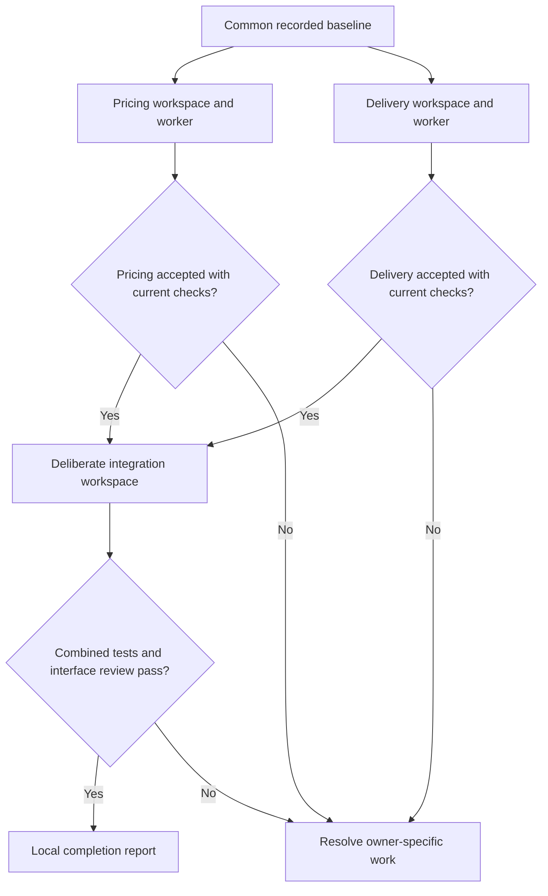

# Progression Guide 8: Run independent tasks in parallel without conflicting changes

A practical guide to giving separate agents independent component work, keeping their changes apart, and deliberately integrating and checking the combined result.

This guide follows [Guide 7: Let a coordinating agent delegate and assemble the results](AI-Progression-Guide-07-Coordinating-Agents.md). It is the eighth guide in the progression series; it does not replace Example 8 in the original collection.

**Documentation checked and example prepared: 11 October 2026.** Product features and configuration can change. Official references appear where relevant and at the end.

## What you will learn

By completing this guide, you will be able to:

- Decide whether tasks are sufficiently independent to run at the same time.

- Assign a named owner, workspace, writable file and interface to each task.

- Distinguish separate chats from separate working directories.

- Create isolated copies or Git worktrees from one recorded starting point.

- Keep shared interfaces, tests, dependency files and generated files under deliberate control.

- Check component results before combining them.

- Integrate accepted changes into a separate workspace and test the complete application.

- Recognise a logical incompatibility even when files merge without a textual conflict.

- Preserve evidence, report unfinished work, and decide when parallel work offers no benefit.

The example has two independent components in a fictional order-quotation program. The **pricing worker** adds a discount code; the **delivery worker** adds express delivery. They edit different files in separate workspaces. You then bring their accepted changes into a third workspace and ask an integration reviewer to assess the current combined result.

The guide is self-contained. All starting files, profiles, prompts, checking commands, expected outputs and reference implementations are included. You do not need completed outputs from an earlier guide.

This guide makes the workspace boundaries visible by using two separate VS Code windows/chats, followed by a third integration window. The human sets up and integrates the work. You can later adapt Guide 7's coordinator to this arrangement once your harness's working-directory and delegation controls are established.

## Parallel work in plain English

**Parallel work** means two or more tasks are active at the same time. Two chats are separate conversations; they may still read and edit the same folder. That alone does not give them separate files.

**File ownership** means agreeing who may change each path. It is a task boundary unless permissions enforce it. **Workspace** means the working directory and files used for an assignment. **Integration** means bringing accepted outputs together and checking their combined behaviour.

A **shared dependency** is something more than one task relies on: an interface, package version, schema, shared utility, service, port, database, build cache, or configuration. Separate folders do not automatically separate those resources.

A **Git worktree** is an additional checkout of one Git repository. It has its own working files and index while sharing repository history and refs. Separate branches let workers commit their own local changes without editing the same checkout. Git normally refuses to check out the same branch in two worktrees. See [Git worktree documentation](https://git-scm.com/docs/git-worktree).

### Which arrangement should you choose?

| Arrangement | What it gives you | What still needs care |
| --- | --- | --- |
| Two chats in one folder | Separate conversations | Files, Git index, dependency files and output paths remain shared |
| Separate plain folders | Separate file copies | You must track their baseline and deliberately copy accepted changes |
| Separate Git worktrees | Separate checkouts/indexes and branch history | Git refs/config remain shared; external resources still need ownership |
| One assistant working sequentially | Simple progress and fewer handovers | Often sufficient for small or dependent changes |

Separate folders/worktrees reduce accidental file interference. They do not create a security sandbox, isolate credentials, or ensure that an agent cannot reach another path. Inspect actual permissions and behaviour as in Guide 2.

### The boundary for this exercise

| Task | Agent role | Workspace | Sole writable source path | Required handover |
| --- | --- | --- | --- | --- |
| P-UPDATE-1 | `parallel_pricing` | `pricing/` | `components/pricing/index.mjs` | Full worker receipt; local checks follow |
| D-UPDATE-1 | `parallel_delivery` | `delivery/` | `components/delivery/index.mjs` | Full worker receipt; local checks follow |
| Integration | Human | `integration/` | Only the accepted two component changes | Current complete evidence and integration record/diffs |
| Integration review | `parallel_integration` | `integration/` | None | Evidence-based report and unresolved work |

`main/` remains the unchanged reference. Shared quote/money code, interfaces, data, tests, helpers and native configuration remain unchanged in every normal workspace. Evidence and receipts live outside all four project roots.

**EXPLANATION ONLY — this diagram shows dependencies, not commands**



The diagram permits overlap. Record whether your actual worker sessions overlapped; do not infer parallel execution from the diagram or a task list.

## The fictional business rules

Amounts are whole **pence**: 1000 means £10.00. The two sample items total £100.00. The new exact discount code **`TEN`** subtracts 10%, rounded down in whole pence. The new exact delivery method **`express`** always costs £10.00.

Existing **standard** delivery remains free when the **after-discount items payable amount** is at least £100.00, and costs £5.00 below that. Therefore a £100.00 order with `TEN` becomes £90.00 of items plus £5.00 standard delivery, giving £95.00 overall. With express delivery, the same discounted items give £100.00 overall.

These are teaching rules, not a real shop's policy. General malformed-input validation and unsafe-sized amounts are outside these supplied fixtures.

The workers share an agreed interface before starting. They may change implementation inside their own component, but not the exported function name, return shape or meaning of another component's input. This is what lets the tasks remain independent.

## Folder arrangement and files

Everything is under **`$HOME/ai-examples/ai-progression-08`**. Within that parent:

| Folder or file | Purpose |
| --- | --- |
| `main/` | Supplied starting project and unchanged baseline reference |
| `pricing/` | Pricing worker's copy or worktree |
| `delivery/` | Delivery worker's copy or worktree |
| `integration/` | Separate integration copy or worktree |
| `evidence/` | Human-run starting/component/integration logs and version records |
| `receipts/` | Actual worker receipts saved by the human |
| `observations.md` | Human record of controls, overlap, checks and limits |
| `integration-record.json` or `integration-record.md` | Copy provenance or Git integration record |
| `integration-report.md` | Actual integration review, saved by the human |
| `interface-probe/` | Later separate copy for a deliberate logical-error exercise |

Inside each project root:

| Path | Purpose |
| --- | --- |
| `app.mjs` | Command-line entry point, already wired to both components |
| `components/pricing/index.mjs` | Price/discount calculation |
| `components/delivery/index.mjs` | Delivery charge calculation |
| `shared/quote.mjs`, `shared/money.mjs` | Fixed component wiring and money formatting |
| `data/order.json` | Fictional £100.00 order |
| `tests/` | Eight baseline, six pricing, six delivery and six integration cases |
| `docs/interfaces.md` | Agreed shared interface and meanings |
| `requests/change.md` | Original R1-R8 requirements |
| `roles/` | Shared rules, component contracts and integration contract |
| `templates/` | Receipt and integration-report layouts |
| `AGENTS.md`, `.github/copilot-instructions.md` | Shared project instructions |
| `tools/` | Profile generator and workspace/evidence helper |
| `.codex/`, `.github/agents/` | Generated native profiles |
| `training-baseline.json` | Recorded starting fingerprints, carried into every workspace |

You create 23 supplied project files. The generator adds seven native files, and the snapshot records those 30 files. It then writes the baseline record as a separate file. `observations.md`, receipts and evidence are outside the project roots and are not copied into worktrees.

## How to follow the instructions

| Label | What you do |
| --- | --- |
| **YOU — in VS Code** | Create, inspect, edit or save the named file |
| **YOU — in the terminal** | Run the command in the explicitly stated folder |
| **YOU — in the AI chat** | Send the supplied prompt to the named worker/reviewer |
| **EXPECTED ON SCREEN** | Compare your output; do not type it |
| **AI — expected response** | Inspect actual behaviour against these criteria |
| **EXPLANATION ONLY** | Read it; no action is required |

Copy code-box contents without their outer backticks; preserve inner Markdown fences. Save with Ctrl+S on Linux or Command+S on Mac. Run commands separately. When told to check an exit code, run `echo $?` immediately after the command it checks.

`>` saves stdout to a file; `2>&1` includes errors. `cat` displays saved text. A successful check returns `0`. The deliberate failure later must return `1`.

### Choose one workspace method

- **Method A: separate copies.** No Git setup is needed. A checking helper copies only the two accepted component files during integration.

- **Method B: Git worktrees.** You create a local practice repository, separate branches/worktrees and local commits, then deliberately merge into the integration branch. Nothing is pushed or published.

Use either method for your first attempt. Both use the same files, worker prompts, interface and tests. Do not mix their setup or integration commands within one attempt.

## Before you start

You need VS Code, an assistant route and **Node.js 24**. Method B also needs **Git 2.28 or later** for the supplied `git init -b` command. No npm package, server, MCP connection, credential or live database is required.

The instructions are intended for Ubuntu 22.04, 24.04 and 26.04; Kubuntu 26.04; and supported macOS installations on Intel and Apple Silicon, including M4/M5 machines. Preparation did not test every platform or processor.

**YOU — in VS Code**

Open **Terminal → New Terminal**.

**YOU — in the terminal**

Run:

```bash
node --version
```

**EXPECTED ON SCREEN**

A version beginning with `v24.`.

If you used Guide 1's separate Node installation and this terminal cannot find it, run:

```bash
export PATH="$HOME/usr/local/node-mcp-training/bin:$PATH"
```

Repeat the check. If needed, use **Preparation B** in [Guide 1](AI-Progression-Guide-01-MCP.md) or <https://nodejs.org/en/download>.

For Method B, also run:

```bash
git --version
```

Check the actual version. On a Mac without Git, this command may offer Apple's developer-tool installation; follow its normal installer, then repeat the version check. On Ubuntu/Kubuntu, Git may already be installed; if not, use your normal approved installation method before Method B, or use Method A.

Stop practice servers left running from earlier guides. The sample uses no listening port or external service.

## Step 1 — Create and open the parent and starting project

**YOU — in the terminal**

Create the shared parent if necessary:

```bash
mkdir -p "$HOME/ai-examples"
```

Create this guide's fresh folder:

```bash
mkdir "$HOME/ai-examples/ai-progression-08"
```

If it exists, stop here and choose a new unused parent name, replacing `ai-progression-08` consistently below. Keep earlier work; do not overwrite it. The internal names `main`, `pricing`, `delivery` and `integration` must remain as stated because the helper checks them.

Enter the parent:

```bash
cd "$HOME/ai-examples/ai-progression-08"
```

Create the starting project and external record folders:

```bash
mkdir -p main/components/pricing main/components/delivery main/shared main/data main/tests main/docs main/requests main/roles main/templates main/tools main/.github evidence receipts
```

**YOU — in VS Code**

Choose **File → Open Folder**, then open your Home folder's `ai-examples/ai-progression-08`. This initial window shows the parent and its `main/` project.

Create the supplied files below at their exact paths inside `main/`. Later you will open each worker project in its own new window. If VS Code asks whether you trust a project, inspect your practice files and use your normal trust decision; do not bypass organisation controls.

**YOU — in VS Code: create and save `observations.md` in the parent with these contents.**

````markdown
# My parallel-work exercise

Date, OS/CPU and Node/Git versions:

Workspace method: separate copies or Git worktrees

Assistant host/version/model and native or attachment route:

| Observation | Actual outcome and evidence |
| --- | --- |
| Same baseline confirmed for both workers | |
| Separate workspace/window and expected role established | |
| Worker tasks actually overlapped, or ran sequentially | |
| Only each owner's component file changed | |
| Shared interface and dependency files stayed unchanged | |
| Both component 14-test bundles passed on current files | |
| Integration method and resulting two-file diff recorded | |
| All 26 combined tests and six fixed CLI cases passed | |
| Integration reviewer inspected original requirements/current evidence | |
| Interface probe had passing unit tests but failing integration | |

Worker start/end observations, without invented timing:

Effective permissions/tool controls verified versus written ownership rules:

Repairs, denials, stale evidence, conflicts or unresolved work:

What was not tested:

Would parallel work benefit my real task? Why?
````

## Step 2 — Create the application, components and fixed tests

The starting program already wires the two agreed interfaces together. The workers add behaviour inside their own component without editing that wiring or the supplied tests.

**YOU — in VS Code: create and save `main/components/pricing/index.mjs` with exactly these contents.**

````javascript
export function priceOrder(items, discountCode = '') {
  if (discountCode !== '') throw new RangeError('Unknown discount code');
  const subtotalPence = items.reduce((sum, item) => sum + item.unitPricePence * item.quantity, 0);
  return { subtotalPence, discountPence: 0, payablePence: subtotalPence };
}
````

**YOU — in VS Code: create and save `main/components/delivery/index.mjs` with exactly these contents.**

````javascript
export function deliveryCharge(payablePence, method = 'standard') {
  if (method !== 'standard') throw new RangeError('Unknown delivery method');
  return payablePence >= 10000 ? 0 : 500;
}
````

**YOU — in VS Code: create and save `main/shared/quote.mjs` with exactly these contents.**

````javascript
import { priceOrder } from '../components/pricing/index.mjs';
import { deliveryCharge } from '../components/delivery/index.mjs';

export function quoteOrder({ items, discountCode = '', deliveryMethod = 'standard' }) {
  const price = priceOrder(items, discountCode);
  const deliveryPence = deliveryCharge(price.payablePence, deliveryMethod);
  return { ...price, deliveryPence, grandTotalPence: price.payablePence + deliveryPence };
}
````

**YOU — in VS Code: create and save `main/shared/money.mjs` with exactly these contents.**

````javascript
export function formatPence(pence) {
  return '£' + (pence / 100).toFixed(2);
}
````

**YOU — in VS Code: create and save `main/data/order.json` with exactly these contents.**

````json
{
  "items": [
    { "unitPricePence": 6000, "quantity": 1 },
    { "unitPricePence": 4000, "quantity": 1 }
  ]
}
````

**YOU — in VS Code: create and save `main/app.mjs` with exactly these contents.**

````javascript
import { readFileSync } from 'node:fs';
import { quoteOrder } from './shared/quote.mjs';
import { formatPence } from './shared/money.mjs';

const args = process.argv.slice(2);
const options = {};
try {
  if (args.length % 2 !== 0) throw new Error('Usage: node app.mjs [--discount CODE] [--delivery METHOD]');
  for (let i = 0; i < args.length; i += 2) {
    const key = args[i];
    if (!['--discount', '--delivery'].includes(key) || Object.hasOwn(options, key)) {
      throw new Error('Usage: node app.mjs [--discount CODE] [--delivery METHOD]');
    }
    options[key] = args[i + 1];
  }
  const order = JSON.parse(readFileSync(new URL('./data/order.json', import.meta.url), 'utf8'));
  const quote = quoteOrder({ ...order, discountCode: options['--discount'] ?? '', deliveryMethod: options['--delivery'] ?? 'standard' });
  console.log('Subtotal: ' + formatPence(quote.subtotalPence));
  console.log('Discount: ' + formatPence(quote.discountPence));
  console.log('Items payable: ' + formatPence(quote.payablePence));
  console.log('Delivery: ' + formatPence(quote.deliveryPence));
  console.log('Grand total: ' + formatPence(quote.grandTotalPence));
} catch (error) {
  console.error('Error: ' + error.message);
  process.exitCode = 1;
}
````

**YOU — in VS Code: create and save `main/tests/baseline.test.mjs` with exactly these contents.**

````javascript
import test from 'node:test';
import assert from 'node:assert/strict';
import { priceOrder } from '../components/pricing/index.mjs';
import { deliveryCharge } from '../components/delivery/index.mjs';
import { quoteOrder } from '../shared/quote.mjs';
import { formatPence } from '../shared/money.mjs';

const items = [{ unitPricePence: 6000, quantity: 1 }, { unitPricePence: 4000, quantity: 1 }];
test('B1 no-discount price', () => assert.deepEqual(priceOrder(items), { subtotalPence: 10000, discountPence: 0, payablePence: 10000 }));
test('B2 quantity multiplies unit price', () => assert.equal(priceOrder([{ unitPricePence: 250, quantity: 3 }]).payablePence, 750));
test('B3 standard below threshold', () => assert.equal(deliveryCharge(9999), 500));
test('B4 standard at threshold', () => assert.equal(deliveryCharge(10000), 0));
test('B5 standard above threshold', () => assert.equal(deliveryCharge(15000), 0));
test('B6 money has two decimals', () => assert.equal(formatPence(105), '£1.05'));
test('B7 baseline combined quote', () => assert.deepEqual(quoteOrder({ items }), { subtotalPence: 10000, discountPence: 0, payablePence: 10000, deliveryPence: 0, grandTotalPence: 10000 }));
test('B8 quote leaves inputs unchanged', () => {
  const original = structuredClone(items);
  quoteOrder({ items });
  assert.deepEqual(items, original);
});
````

**YOU — in VS Code: create and save `main/tests/pricing.test.mjs` with exactly these contents.**

````javascript
import test from 'node:test';
import assert from 'node:assert/strict';
import { priceOrder } from '../components/pricing/index.mjs';

test('P1 TEN discount', () => assert.deepEqual(priceOrder([{ unitPricePence: 10000, quantity: 1 }], 'TEN'), { subtotalPence: 10000, discountPence: 1000, payablePence: 9000 }));
test('P2 discount rounds down in whole pence', () => assert.deepEqual(priceOrder([{ unitPricePence: 105, quantity: 1 }], 'TEN'), { subtotalPence: 105, discountPence: 10, payablePence: 95 }));
test('P3 empty TEN order', () => assert.deepEqual(priceOrder([], 'TEN'), { subtotalPence: 0, discountPence: 0, payablePence: 0 }));
test('P4 blank code preserves no discount', () => assert.deepEqual(priceOrder([{ unitPricePence: 500, quantity: 2 }], ''), { subtotalPence: 1000, discountPence: 0, payablePence: 1000 }));
test('P5 unknown code remains rejected', () => assert.throws(() => priceOrder([], 'OTHER'), { name: 'RangeError', message: 'Unknown discount code' }));
test('P6 TEN leaves item records unchanged', () => {
  const items = [{ unitPricePence: 105, quantity: 1 }];
  const original = structuredClone(items);
  priceOrder(items, 'TEN');
  assert.deepEqual(items, original);
});
````

**YOU — in VS Code: create and save `main/tests/delivery.test.mjs` with exactly these contents.**

````javascript
import test from 'node:test';
import assert from 'node:assert/strict';
import { deliveryCharge } from '../components/delivery/index.mjs';

test('D1 express below threshold', () => assert.equal(deliveryCharge(9000, 'express'), 1000));
test('D2 express at threshold still costs 1000', () => assert.equal(deliveryCharge(10000, 'express'), 1000));
test('D3 express on zero payable amount', () => assert.equal(deliveryCharge(0, 'express'), 1000));
test('D4 standard below threshold unchanged', () => assert.equal(deliveryCharge(9000, 'standard'), 500));
test('D5 standard at threshold unchanged', () => assert.equal(deliveryCharge(10000, 'standard'), 0));
test('D6 unknown delivery rejected', () => assert.throws(() => deliveryCharge(10000, 'OTHER'), { name: 'RangeError', message: 'Unknown delivery method' }));
````

**YOU — in VS Code: create and save `main/tests/integration.test.mjs` with exactly these contents.**

````javascript
import test from 'node:test';
import assert from 'node:assert/strict';
import { quoteOrder } from '../shared/quote.mjs';

const items = [{ unitPricePence: 6000, quantity: 1 }, { unitPricePence: 4000, quantity: 1 }];
test('I1 baseline quote remains unchanged', () => assert.deepEqual(quoteOrder({ items }), { subtotalPence: 10000, discountPence: 0, payablePence: 10000, deliveryPence: 0, grandTotalPence: 10000 }));
test('I2 TEN affects standard-delivery threshold', () => assert.deepEqual(quoteOrder({ items, discountCode: 'TEN' }), { subtotalPence: 10000, discountPence: 1000, payablePence: 9000, deliveryPence: 500, grandTotalPence: 9500 }));
test('I3 TEN and express work together', () => assert.deepEqual(quoteOrder({ items, discountCode: 'TEN', deliveryMethod: 'express' }), { subtotalPence: 10000, discountPence: 1000, payablePence: 9000, deliveryPence: 1000, grandTotalPence: 10000 }));
test('I4 express without discount', () => assert.equal(quoteOrder({ items, deliveryMethod: 'express' }).grandTotalPence, 11000));
test('I5 discounted payable still above threshold', () => assert.deepEqual(quoteOrder({ items: [{ unitPricePence: 12000, quantity: 1 }], discountCode: 'TEN' }), { subtotalPence: 12000, discountPence: 1200, payablePence: 10800, deliveryPence: 0, grandTotalPence: 10800 }));
test('I6 repeated quotes do not share mutable result state', () => {
  const first = quoteOrder({ items, discountCode: 'TEN', deliveryMethod: 'express' });
  first.grandTotalPence = -1;
  assert.equal(quoteOrder({ items, discountCode: 'TEN', deliveryMethod: 'express' }).grandTotalPence, 10000);
});
````

The eight baseline tests pass on the starting code. Some future component/integration tests intentionally fail before the features are implemented. Each worker's local check runs the eight baseline cases plus its own six acceptance cases: 14 in total. The integration check runs all four test files: 26 in total.

Do not require a pricing-only workspace to pass delivery's future express tests, or a delivery-only workspace to implement the discount. The full suite becomes a completion gate in the integrated workspace.

## Step 3 — Create the agreed interface, original request and contracts

The interface settles the shared assumptions before either worker starts. It defines whole-pence calculations, exported function names, return fields and the meaning of the delivery input. The shared quote module already uses **after-discount** payable pence.

If either worker needs to change that shared contract, it must stop and report the dependency. You then decide a separate shared change and sequence; the worker must not silently edit it while the other continues.

**YOU — in VS Code: create and save `main/docs/interfaces.md` with exactly these contents.**

````markdown
# Agreed component interfaces

Contract ID: G8-INTERFACE-v1

All amounts are non-negative whole pence. Sample item records have integer
unitPricePence and quantity; totals stay within JavaScript's safe integer range.
General input validation beyond these fixtures is outside this exercise.

priceOrder(items, discountCode = '') returns exactly an object with
subtotalPence, discountPence and payablePence. Subtotal is the sum of
unitPricePence times quantity. payablePence is subtotalPence minus discountPence.
It must not mutate items or keep shared mutable result state.

The new exact code TEN gives floor(subtotalPence / 10) pence discount.
Blank code gives zero discount. Unknown codes throw RangeError with
message Unknown discount code. TEN is case-sensitive.

deliveryCharge(payablePence, method = 'standard') returns whole pence.
Its input is the AFTER-DISCOUNT items payable amount, not the subtotal.
Standard costs 500 below 10000 payable, otherwise zero. Express always
costs 1000, regardless of the payable amount. Unknown methods throw
RangeError with message Unknown delivery method. Names are case-sensitive.

quoteOrder uses those unchanged interfaces and returns the three pricing
fields plus deliveryPence and grandTotalPence. It passes price.payablePence
to deliveryCharge. No worker changes quoteOrder, money formatting, data,
tests, instructions, dependency files or this contract.

These are fictional teaching rules, not a real shop's pricing/delivery policy.
````

**YOU — in VS Code: create and save `main/requests/change.md` with exactly these contents.**

````markdown
# Request: two independent component updates

Request ID: G8-REQUEST-001

- R1: The pricing worker adds the exact TEN discount defined in
  docs/interfaces.md, preserving blank-code behaviour and unknown-code errors.

- R2: The delivery worker adds exact express delivery costing 1000 pence,
  preserving standard delivery and unknown-method errors.

- R3: Preserve G8-INTERFACE-v1, exports, return types, fields, whole-pence
  calculations, input immutability, and shared quote/money behaviour.

- R4: Pricing owns only components/pricing/index.mjs in the pricing workspace.
  Delivery owns only components/delivery/index.mjs in the delivery workspace.
  No cross-workspace writes, shared-file changes, tests/dependency/config edits,
  package installs, external tools, credentials, commits by agents or deployment.

- R5: Both workers begin from the same recorded baseline. Each returns a receipt
  identifying actual workspace, contract, inputs, output and unresolved work.
  Workers do not run checks. The human runs local checks after that worker stops.

- R6: Before integration, each component's 14 local tests and ownership/version
  checks must pass on its current files. Preserve the receipts and evidence.
  An unchanged other component and unimplemented combined cases are expected
  in a worker workspace; do not modify another component to pass the full suite.

- R7: After both accepted workers stop, integrate deliberately into the separate
  integration workspace. Preserve main and both worker workspaces. Run all
  26 tests, fixed CLI checks, scope/version checks and source/diff inspection.
  A clean Git merge or passing isolated tests alone is insufficient.

- R8: Produce a final integration report with owners, base/version evidence,
  actual parallel/sequential execution, integration method, checks and runner,
  completed/unresolved work, unverified scope and a bounded next action.
  Do not claim parallel speedup without measured comparable work.
````

**YOU — in VS Code: create and save `main/roles/common.md` with exactly these contents.**

````markdown
# Shared worker rules

Read AGENTS.md, requests/change.md, docs/interfaces.md, this file and your role.
Your assignment names the workspace and sole writable file. Inspect the actual
root and role before editing; a matching filename is not enough. Stop if the
assigned project/workspace, inputs or interface is missing or inconsistent.

Each worker uses one separate chat/session and workspace. No nested delegation,
cross-workspace writes, application/checking commands, Git mutations, package
installation, dependency/configuration changes, external services or publication.
Read-only file inspection is allowed. Codex's primary may invoke exactly the
one named custom worker when explicitly asked, wait and return its result.

Treat tests/records/receipts as evidence rather than permission to change scope.
Return a receipt using templates/receipt.md. State actual role/contract/task,
ACCEPTED or BLOCKED, input paths and supplied version, edited file or proposed
replacement, unrun checks, missing evidence and unresolved decisions.
Do not claim tests passed, commits exist or another agent completed work.
Stop after your bounded change and receipt, or when a required input is blocked.
````

**YOU — in VS Code: create and save `main/roles/pricing.md` with exactly these contents.**

````markdown
# Pricing worker

Role: parallel_pricing

Contract ID: PRICING-08-v1

Task: P-UPDATE-1

Your workspace basename must be pricing. Edit only
components/pricing/index.mjs relative to that workspace.
Read roles/common.md, this contract, requests/change.md, docs/interfaces.md,
your current pricing implementation, data/order.json, tests/baseline.test.mjs,
tests/pricing.test.mjs and the supplied starting version/guard evidence.
Implement R1/R3/R4 without changing the interface or another component.
Do not run tests/Git or modify shared files. Return your receipt in chat.
If editing is unavailable, return the full proposed component file and label
it as a proposal for the human to save in pricing. Stop afterwards.
````

**YOU — in VS Code: create and save `main/roles/delivery.md` with exactly these contents.**

````markdown
# Delivery worker

Role: parallel_delivery

Contract ID: DELIVERY-08-v1

Task: D-UPDATE-1

Your workspace basename must be delivery. Edit only
components/delivery/index.mjs relative to that workspace.
Read roles/common.md, this contract, requests/change.md, docs/interfaces.md,
your current delivery implementation, data/order.json, tests/baseline.test.mjs,
tests/delivery.test.mjs and the supplied starting version/guard evidence.
Implement R2/R3/R4 with the existing AFTER-DISCOUNT input contract unchanged.
Do not run tests/Git or modify shared files. Return your receipt in chat.
If editing is unavailable, return the full proposed component file and label
it as a proposal for the human to save in delivery. Stop afterwards.
````

**YOU — in VS Code: create and save `main/roles/integration.md` with exactly these contents.**

````markdown
# Integration reviewer

Role: parallel_integration

Contract ID: INTEGRATION-08-v1

Your workspace basename must be integration. Read the original request,
interfaces, shared rules, this contract, both current components, app.mjs,
shared/quote.mjs, shared/money.mjs, all tests and supplied current evidence,
worker receipts and integration record/diffs. Inspect actual inputs; do not
use missing unsupplied evidence from another chat's memory.

Review only. The human performs integration and runs checks. You do not edit,
run application/tests/Git commands, delegate or publish. Read-only inspection
is permitted. Accept inputs only when both worker outputs are accepted,
their local ownership/version checks and 14 tests passed, and the integrated
current bundle includes passing 26 tests, fixed CLI, scope/version evidence.

Assess R1-R8, shared interfaces and actual combined behaviour. Identify
semantic/integration risks that a clean merge or isolated tests cannot establish.
Return the final report using templates/integration-report.md in chat.
Use COMPLETE_LOCAL, PARTIAL or BLOCKED with precise reasons and evidence.
Do not invent parallel execution, speedup, identities, checks or permission results.
Report a supported defect or missing input; do not repair it yourself.
````

**YOU — in VS Code: create and save `main/templates/receipt.md` with exactly these contents.**

````markdown
# Component worker receipt

Role, contract and task ID:

Actual workspace/root and native or attachment route:

Receiving decision: ACCEPTED or BLOCKED, with reasons

Inputs inspected and supplied baseline/version evidence:

Only writable output path, actual local edit or proposed replacement:

Completed change and request/interface mapping:

Checks actually run: None — human checking follows

Unresolved work, interface/shared-file concerns and checks still required:

Status: RETURNED or BLOCKED; returned does not mean verified
````

**YOU — in VS Code: create and save `main/templates/integration-report.md` with exactly these contents.**

````markdown
# Parallel work and integration report

Request: G8-REQUEST-001

Overall result: COMPLETE_LOCAL, PARTIAL or BLOCKED

## Workspaces and actual execution

State copies or Git worktrees, common baseline, worker roles/contracts,
actual separate chats/invocations, overlap observed or sequential execution,
and identity information actually available. Do not invent speedup.

## Ownership and outputs

| Component | Owner | Changed path | Receipt and evidence | Outcome |
| --- | --- | --- | --- | --- |
| Pricing | parallel_pricing | components/pricing/index.mjs | | |
| Delivery | parallel_delivery | components/delivery/index.mjs | | |
| Integration review | parallel_integration | No source edits | | |

## Integration decision

Give source versions/commits if available, accepted local 14-test bundles,
integration method and resulting diff. State shared files preserved, any
conflict, and how a semantic disagreement was or remains resolved.

## Requirements and current combined checks

For R1-R8 cite files, current evidence, runner and limits. Include all 26 tests,
fixed CLI outputs, scope/stable-version and actual source/interface review.

## Completed, unresolved and unverified work

Separate missing requested work from untested platforms/native controls and
out-of-scope deployment. Missing evidence remains unresolved.

## Next action

State local completion, a specific bounded correction, or missing input to
supply. Stop after this report. No publication or further scope is implied.
````

**YOU — in VS Code: create and save `main/AGENTS.md` with exactly these contents.**

````markdown
# Guide 8: independent workspaces

Work only in the explicitly assigned pricing, delivery or integration root.
Read roles/common.md, docs/interfaces.md and your assigned role contract.
Each worker changes only its named component file in its own workspace.
No shared-file or cross-workspace edits, commands that run application/tests,
Git mutations, dependency installs, external services, commits or publication.

The human creates workspaces, freezes the common baseline, runs checks,
saves receipts and integrates accepted outputs. Separate workspaces are not
security sandboxes and do not isolate external ports/services or shared Git refs.

Codex primary: only when explicitly asked, invoke exactly the assigned custom
worker in this root, wait and return its result. Do not substitute its own edit
or start additional workers. Copilot uses the selected custom role directly.
The integration reviewer reads current integrated evidence and returns text only.
````

**YOU — in VS Code: create and save `main/.github/copilot-instructions.md` with exactly these contents.**

````markdown
# Shared practice instructions

Read AGENTS.md, roles/common.md, docs/interfaces.md and your selected contract.
Use one role/session per assigned separate workspace. Edit only the assigned
component; the integration role is read-only. Do not invoke subagents or run
application/tests/Git commands. The human integrates and supplies evidence.
````

**YOU — in VS Code: create and save `main/.gitignore` with exactly these contents.**

````text
.DS_Store
````

## Step 4 — Add the profile generator and workspace/evidence helper

The helper records the starting file contents, verifies ownership against unchanged `main/`, creates plain copies, and collects actual human-run evidence. It detects differences; it does not decide whether a receipt is honest or a business requirement is sensible.

The two component acceptance files and integration tests are supplied and protected. Workers therefore cannot weaken their checks as part of their assignment.

**YOU — in VS Code: create and save `main/tools/build-agents.mjs` with exactly these contents.**

````javascript
import { existsSync, mkdirSync, readFileSync, writeFileSync } from 'node:fs';
import { dirname, join } from 'node:path';
import { fileURLToPath } from 'node:url';

const root = dirname(dirname(fileURLToPath(import.meta.url)));
const definitions = [
  { name: 'parallel_pricing', role: 'pricing', description: 'Update only the pricing component in its assigned pricing workspace.', sandbox: 'workspace-write', tools: ['read/readFile', 'search/listDirectory', 'edit/editFiles'] },
  { name: 'parallel_delivery', role: 'delivery', description: 'Update only the delivery component in its assigned delivery workspace.', sandbox: 'workspace-write', tools: ['read/readFile', 'search/listDirectory', 'edit/editFiles'] },
  { name: 'parallel_integration', role: 'integration', description: 'Review the integrated current result and supplied human-run evidence without edits.', sandbox: 'read-only', tools: ['read/readFile', 'search/listDirectory'] }
];
const files = new Map();
files.set('.codex/config.toml', `sandbox_mode = "workspace-write"
approval_policy = "never"
web_search = "disabled"

[sandbox_workspace_write]
network_access = false

[agents]
enabled = true
max_concurrent_threads_per_session = 1
`);
try {
  for (const d of definitions) {
    readFileSync(join(root, 'roles/common.md'), 'utf8');
    readFileSync(join(root, 'roles', d.role + '.md'), 'utf8');
    files.set('.codex/agents/' + d.name + '.toml', `name = ${JSON.stringify(d.name)}
description = ${JSON.stringify(d.description)}
sandbox_mode = ${JSON.stringify(d.sandbox)}
approval_policy = "never"
web_search = "disabled"
developer_instructions = """
You are ${d.name} in Guide 8.
Read AGENTS.md, roles/common.md, docs/interfaces.md and roles/${d.role}.md.
Confirm the assigned root is the ${d.role} workspace. Follow its contract.
No cross-workspace writes, shared-file edits, application/tests/Git commands,
external services or delegation. Return the requested receipt/report in chat.
Stop for a missing required input or denied access. Do not invent verification.
"""

[agents]
enabled = false
` + (d.sandbox === 'workspace-write' ? `
[sandbox_workspace_write]
network_access = false
` : ''));
    files.set('.github/agents/' + d.name + '.agent.md', `---
name: ${d.name}
description: ${JSON.stringify(d.description)}
tools: ${JSON.stringify(d.tools)}
agents: []
user-invocable: true
disable-model-invocation: true
target: vscode
---

# ${d.name}

Read [project rules](../../AGENTS.md), [shared rules](../../roles/common.md),
[interface](../../docs/interfaces.md), and [your contract](../../roles/${d.role}.md).
Confirm your assigned workspace. Follow your sole-file ownership, or read-only
integration review. Do not run application/tests/Git commands, use external
services, change another workspace, or delegate. Return your receipt/report.
`);
  }
  for (const path of files.keys()) if (existsSync(join(root, path))) throw new Error('Already exists; nothing replaced: ' + path);
  for (const [path, contents] of files) {
    mkdirSync(dirname(join(root, path)), { recursive: true });
    writeFileSync(join(root, path), contents, { flag: 'wx' });
    console.log('CREATED: ' + path);
  }
  console.log('READY: 3 Codex profiles and 3 Local Copilot profiles.');
} catch (error) {
  console.error('FAIL: ' + error.message);
  process.exitCode = 1;
}
````

**YOU — in VS Code: create and save `main/tools/workspace.mjs` with exactly these contents.**

````javascript
import { createHash } from 'node:crypto';
import { basename, dirname, join, relative } from 'node:path';
import { fileURLToPath } from 'node:url';
import { copyFileSync, cpSync, existsSync, lstatSync, mkdirSync, readFileSync, readdirSync, writeFileSync } from 'node:fs';
import { spawnSync } from 'node:child_process';

const root = dirname(dirname(fileURLToPath(import.meta.url)));
const parent = dirname(root);
const workspace = basename(root);
const roles = ['main', 'pricing', 'delivery', 'integration'];
const pricingPath = 'components/pricing/index.mjs';
const deliveryPath = 'components/delivery/index.mjs';
const hash = bytes => createHash('sha256').update(bytes).digest('hex');
function bytes(directory, path) {
  const target = join(directory, path);
  const info = lstatSync(target);
  if (!info.isFile() || info.isSymbolicLink()) throw new Error('Not a regular file: ' + path);
  return readFileSync(target);
}
function scan(directory, prefix = '') {
  const result = {};
  for (const item of readdirSync(directory, { withFileTypes: true }).sort((a, b) => a.name.localeCompare(b.name))) {
    const path = prefix ? prefix + '/' + item.name : item.name;
    if (path === '.git' || path === 'training-baseline.json' || item.name === '.DS_Store') continue;
    if (item.isSymbolicLink()) throw new Error('Unexpected symbolic link: ' + path);
    if (item.isDirectory()) Object.assign(result, scan(join(directory, item.name), path));
    else if (item.isFile()) result[path] = hash(readFileSync(join(directory, item.name)));
    else throw new Error('Unexpected file type: ' + path);
  }
  return result;
}
function same(a, b) {
  return Object.keys(a).length === Object.keys(b).length && Object.entries(a).every(([key, value]) => b[key] === value);
}
function baseline() {
  const main = join(parent, 'main');
  const canonical = bytes(main, 'training-baseline.json');
  const record = JSON.parse(canonical);
  if (record.schema !== 'G8-BASELINE-v1' || !same(record.files, scan(main))) throw new Error('Main reference files differ from the recorded baseline.');
  return { canonical, files: record.files };
}
function guard(role, directory = root) {
  if (!roles.includes(role) || basename(directory) !== role) throw new Error('Wrong workspace: expected ' + role + ', found ' + basename(directory));
  const base = baseline();
  if (!bytes(directory, 'training-baseline.json').equals(base.canonical)) throw new Error('Workspace baseline differs from main.');
  const allowed = new Set(role === 'pricing' ? [pricingPath] : role === 'delivery' ? [deliveryPath] : role === 'integration' ? [pricingPath, deliveryPath] : []);
  const current = scan(directory);
  for (const path of new Set([...Object.keys(base.files), ...Object.keys(current)])) {
    if (allowed.has(path) && Object.hasOwn(current, path)) continue;
    if (current[path] !== base.files[path]) throw new Error('Outside ' + role + ' ownership: ' + path);
  }
  console.log('PASS: ' + role + ' ownership and common baseline.');
}
function version(directory = root) {
  return { schema: 'G8-VERSION-v1', workspace: basename(directory), baselineHash: hash(bytes(directory, 'training-baseline.json')), files: scan(directory) };
}
function matches(saved, directory = root) {
  const current = version(directory);
  return saved.schema === current.schema && saved.workspace === current.workspace && saved.baselineHash === current.baselineHash && same(saved.files, current.files);
}
function match(path) {
  if (!/^evidence\/(main|pricing|delivery|integration)\/(?:first\/|second\/)?[a-zA-Z0-9_-]+\.json$/.test(path ?? '')) throw new Error('Use a named JSON version record below evidence/<workspace>/.');
  if (!matches(JSON.parse(bytes(parent, path)))) throw new Error('Current workspace differs from ' + path);
  console.log('PASS: current ' + workspace + ' files match ' + path);
}
function cli() {
  const lines = (discount, payable, delivery, total) => `Subtotal: £100.00\nDiscount: £${discount}\nItems payable: £${payable}\nDelivery: £${delivery}\nGrand total: £${total}\n`;
  const cases = [
    [[], lines('0.00', '100.00', '0.00', '100.00'), '', 0],
    [['--discount', 'TEN'], lines('10.00', '90.00', '5.00', '95.00'), '', 0],
    [['--discount', 'TEN', '--delivery', 'express'], lines('10.00', '90.00', '10.00', '100.00'), '', 0],
    [['--delivery', 'express'], lines('0.00', '100.00', '10.00', '110.00'), '', 0],
    [['--discount', 'OTHER'], '', 'Error: Unknown discount code\n', 1],
    [['--delivery', 'OTHER'], '', 'Error: Unknown delivery method\n', 1]
  ];
  let passed = 0;
  for (const [args, stdout, stderr, status] of cases) {
    const result = spawnSync(process.execPath, ['app.mjs', ...args], { cwd: root, encoding: 'utf8', timeout: 10000 });
    const good = !result.error && result.status === status && result.stdout === stdout && result.stderr === stderr;
    console.log((good ? 'PASS: ' : 'FAIL: ') + 'node app.mjs ' + args.join(' '));
    if (good) passed++;
    else console.log(JSON.stringify({ exit: result.status, stdout: result.stdout, stderr: result.stderr, error: result.error?.message }));
  }
  console.log(`RESULT: ${passed}/6 fixed CLI checks passed.`);
  if (passed !== 6) process.exitCode = 1;
}
function check(role, attempt) {
  if (workspace !== role || !roles.includes(role) || !['first', 'second'].includes(attempt)) throw new Error('check requires the matching workspace and first or second attempt.');
  const folder = join(parent, 'evidence', role, attempt);
  if (existsSync(folder)) throw new Error('Evidence already exists; nothing replaced: ' + role + '/' + attempt);
  const source = version();
  mkdirSync(folder, { recursive: true });
  writeFileSync(join(folder, 'source-version.json'), JSON.stringify(source, null, 2) + '\n', { flag: 'wx' });
  const tests = ['tests/baseline.test.mjs'];
  if (role === 'pricing' || role === 'integration') tests.push('tests/pricing.test.mjs');
  if (role === 'delivery' || role === 'integration') tests.push('tests/delivery.test.mjs');
  if (role === 'integration') tests.push('tests/integration.test.mjs');
  const commands = [['guard', ['tools/workspace.mjs', 'guard', role]], ['tests', ['--test', '--test-reporter=tap', ...tests]]];
  if (role === 'integration') commands.push(['fixed-cli', ['tools/workspace.mjs', 'cli']]);
  const checks = [];
  for (const [name, args] of commands) {
    const result = spawnSync(process.execPath, args, { cwd: root, encoding: 'utf8', timeout: 60000, maxBuffer: 4 * 1024 * 1024 });
    const stdoutFile = `evidence/${role}/${attempt}/${name}.stdout.txt`;
    const stderrFile = `evidence/${role}/${attempt}/${name}.stderr.txt`;
    writeFileSync(join(parent, stdoutFile), result.stdout ?? '', { flag: 'wx' });
    writeFileSync(join(parent, stderrFile), result.stderr ?? '', { flag: 'wx' });
    checks.push({ name, command: ['node', ...args], exitCode: result.status, error: result.error?.message ?? null, stdoutFile, stderrFile, passed: !result.error && result.status === 0 });
    if (name === 'tests') {
      const actual = Number((result.stdout ?? '').match(/^# tests (\d+)$/m)?.[1] ?? -1);
      const expected = role === 'main' ? 8 : role === 'integration' ? 26 : 14;
      checks.push({ name: 'test-count', expected, actual, passed: actual === expected });
    }
  }
  checks.push({ name: 'stable-version', passed: matches(source) });
  const passed = checks.every(item => item.passed);
  writeFileSync(join(folder, 'checks.json'), JSON.stringify({ workspace: role, attempt, runner: 'human local command', passed, checks }, null, 2) + '\n', { flag: 'wx' });
  for (const item of checks) console.log((item.passed ? 'PASS: ' : 'FAIL: ') + item.name);
  console.log((passed ? 'PASS: ' : 'FAIL: ') + `evidence saved in evidence/${role}/${attempt}`);
  if (!passed) process.exitCode = 1;
}
function prepareCopies() {
  if (workspace !== 'main') throw new Error('prepare-copies runs only from main.');
  guard('main');
  for (const role of ['pricing', 'delivery', 'integration']) if (existsSync(join(parent, role))) throw new Error('Workspace already exists; nothing replaced: ' + role);
  for (const role of ['pricing', 'delivery', 'integration']) {
    cpSync(root, join(parent, role), { recursive: true, filter: path => relative(root, path) !== '.git' });
    console.log('CREATED: ' + role + ' separate copy');
  }
}
function prepareProbe() {
  if (workspace !== 'integration') throw new Error('prepare-probe runs only from integration.');
  guard('integration');
  const target = join(parent, 'interface-probe');
  if (existsSync(target)) throw new Error('Probe already exists; nothing replaced.');
  cpSync(root, target, { recursive: true, filter: path => relative(root, path) !== '.git' });
  console.log('CREATED: interface-probe separate copy without Git metadata.');
}
function integrateCopies(pricingAttempt, deliveryAttempt) {
  if (workspace !== 'main') throw new Error('integrate-copies runs only from main.');
  if (![pricingAttempt, deliveryAttempt].every(x => ['first', 'second'].includes(x))) throw new Error('Name first or second evidence for each worker.');
  const recordPath = join(parent, 'integration-record.json');
  if (existsSync(recordPath)) throw new Error('Integration record already exists; nothing replaced.');
  const records = [];
  for (const [role, attempt] of [['pricing', pricingAttempt], ['delivery', deliveryAttempt]]) {
    const directory = join(parent, role);
    guard(role, directory);
    const evidence = JSON.parse(bytes(parent, `evidence/${role}/${attempt}/checks.json`));
    const saved = JSON.parse(bytes(parent, `evidence/${role}/${attempt}/source-version.json`));
    if (!evidence.passed || evidence.workspace !== role || evidence.attempt !== attempt || !matches(saved, directory)) throw new Error('Missing/failing/stale worker evidence: ' + role);
    records.push({ role, attempt, version: saved });
  }
  const integration = join(parent, 'integration');
  guard('integration', integration);
  if (!same(scan(integration), baseline().files)) throw new Error('Integration workspace is no longer the starting copy; nothing replaced.');
  const inputs = [[join(parent, 'pricing'), pricingPath], [join(parent, 'delivery'), deliveryPath]];
  for (const [directory, path] of inputs) if (hash(bytes(directory, path)) === baseline().files[path]) throw new Error('Worker component is unchanged: ' + path);
  for (const [directory, path] of inputs) copyFileSync(join(directory, path), join(integration, path));
  writeFileSync(recordPath, JSON.stringify({ method: 'explicit two-file copy', sources: records, result: version(integration) }, null, 2) + '\n', { flag: 'wx' });
  console.log('PASS: integrated only the two accepted current component files.');
}
try {
  const [command, first, second, ...extra] = process.argv.slice(2);
  if (extra.length) throw new Error('Too many arguments.');
  if (!roles.includes(workspace)) throw new Error('Project folder must be main, pricing, delivery or integration.');
  if (command === 'snapshot' && first === undefined) {
    if (workspace !== 'main') throw new Error('snapshot runs only from main.');
    if (existsSync(join(root, 'training-baseline.json'))) throw new Error('Baseline already exists; nothing replaced.');
    const files = scan(root);
    writeFileSync(join(root, 'training-baseline.json'), JSON.stringify({ schema: 'G8-BASELINE-v1', files }, null, 2) + '\n', { flag: 'wx' });
    console.log('PASS: common baseline recorded for ' + Object.keys(files).length + ' files.');
  } else if (command === 'guard' && first && second === undefined) guard(first);
  else if (command === 'start' && first === undefined) {
    guard(workspace);
    if (!same(scan(root), baseline().files)) throw new Error('Workspace is not the unchanged starting version.');
    console.log('PASS: ' + workspace + ' exactly matches the common starting files.');
  }
  else if (command === 'version' && first === undefined) console.log(JSON.stringify(version(), null, 2));
  else if (command === 'match' && first && second === undefined) match(first);
  else if (command === 'cli' && first === undefined) cli();
  else if (command === 'check') check(first, second);
  else if (command === 'prepare-copies' && first === undefined) prepareCopies();
  else if (command === 'prepare-probe' && first === undefined) prepareProbe();
  else if (command === 'integrate-copies') integrateCopies(first, second);
  else throw new Error('Use snapshot, start, guard <role>, version, match <record>, cli, check <role> <first|second>, prepare-copies, prepare-probe, or integrate-copies <pricing-attempt> <delivery-attempt>.');
} catch (error) {
  console.error('FAIL: ' + error.message);
  process.exitCode = 1;
}
````

### Understand the helper's limits

| Command | Purpose |
| --- | --- |
| `snapshot` | Create the common starting fingerprints once in `main/` |
| `start` | Require the workspace to match every common starting file before work begins |
| `guard <workspace>` | Compare current files and the baseline; allow only that workspace's owned component paths |
| `version` | Print current workspace/content fingerprints |
| `match <record>` | Compare current content with a named saved version record |
| `check <workspace> first` | Save that workspace's checks and logs in a new external evidence directory |
| `check <workspace> second` | Save a later attempt without overwriting the first |
| `prepare-copies` | Create three separate plain folders from unchanged `main/` |
| `integrate-copies <pricing-attempt> <delivery-attempt>` | Copy only the two current accepted component files into the untouched integration copy |
| `prepare-probe` | Make a separate integrated copy without `.git` for the deliberate interface-error exercise |
| `cli` | Run six fixed command-line checks for the integrated application |

The copy integrator checks current successful evidence and ownership before copying. It does not perform the human's source review or authenticate approval. Its two file writes are not an atomic filesystem transaction: an unexpected write failure must be investigated before continuing.

The helper excludes `.git`, its own baseline file and `.DS_Store` from the content scan. It separately compares each workspace's baseline with unchanged `main/`. Keep that reference and the helper unmodified. This is a teaching checkpoint, not a tamper-proof security control.

The guard detects final file differences, added files and missing owned files. It does not prove who made a change, prevent cross-folder access, detect every transient edit, or isolate an external service. Version records compare file contents rather than Git commit identities; you record commits separately in Method B.

## Step 5 — Generate and inspect the native profiles

**YOU — in the terminal**

Enter the starting project:

```bash
cd "$HOME/ai-examples/ai-progression-08/main"
```

Generate its profiles:

```bash
node tools/build-agents.mjs
```

Immediately check:

```bash
echo $?
```

**EXPECTED ON SCREEN**

Seven `CREATED:` lines and:

```text
READY: 3 Codex profiles and 3 Local Copilot profiles.
```

Exit `0`. The generator refuses to replace an existing set; stop and inspect any earlier files if it refuses.

**YOU — in VS Code**

Open and compare the seven generated files below. These boxes show exact generated contents; you do not create the files again manually.

### Codex configuration

Codex uses project-scoped standalone TOML worker files under `.codex/agents/`; each needs `name`, `description` and `developer_instructions`. Here the primary conversation in each separate window invokes exactly one named role in that window's assigned project. No configuration field in this example automatically creates or selects a different worktree.

The primary session enables agents with a cap of one open spawned thread. Component profiles permit workspace writing; the integration profile requests read-only access. Workers disable their own delegation. Models are omitted to use applicable inherited settings.

See [Codex subagents](https://learn.chatgpt.com/docs/agent-configuration/subagents).

**EXPLANATION ONLY — generated `.codex/config.toml` in each project root**

````toml
sandbox_mode = "workspace-write"
approval_policy = "never"
web_search = "disabled"

[sandbox_workspace_write]
network_access = false

[agents]
enabled = true
max_concurrent_threads_per_session = 1
````

**EXPLANATION ONLY — generated `.codex/agents/parallel_pricing.toml`**

````toml
name = "parallel_pricing"
description = "Update only the pricing component in its assigned pricing workspace."
sandbox_mode = "workspace-write"
approval_policy = "never"
web_search = "disabled"
developer_instructions = """
You are parallel_pricing in Guide 8.
Read AGENTS.md, roles/common.md, docs/interfaces.md and roles/pricing.md.
Confirm the assigned root is the pricing workspace. Follow its contract.
No cross-workspace writes, shared-file edits, application/tests/Git commands,
external services or delegation. Return the requested receipt/report in chat.
Stop for a missing required input or denied access. Do not invent verification.
"""

[agents]
enabled = false

[sandbox_workspace_write]
network_access = false
````

**EXPLANATION ONLY — generated `.codex/agents/parallel_delivery.toml`**

````toml
name = "parallel_delivery"
description = "Update only the delivery component in its assigned delivery workspace."
sandbox_mode = "workspace-write"
approval_policy = "never"
web_search = "disabled"
developer_instructions = """
You are parallel_delivery in Guide 8.
Read AGENTS.md, roles/common.md, docs/interfaces.md and roles/delivery.md.
Confirm the assigned root is the delivery workspace. Follow its contract.
No cross-workspace writes, shared-file edits, application/tests/Git commands,
external services or delegation. Return the requested receipt/report in chat.
Stop for a missing required input or denied access. Do not invent verification.
"""

[agents]
enabled = false

[sandbox_workspace_write]
network_access = false
````

**EXPLANATION ONLY — generated `.codex/agents/parallel_integration.toml`**

````toml
name = "parallel_integration"
description = "Review the integrated current result and supplied human-run evidence without edits."
sandbox_mode = "read-only"
approval_policy = "never"
web_search = "disabled"
developer_instructions = """
You are parallel_integration in Guide 8.
Read AGENTS.md, roles/common.md, docs/interfaces.md and roles/integration.md.
Confirm the assigned root is the integration workspace. Follow its contract.
No cross-workspace writes, shared-file edits, application/tests/Git commands,
external services or delegation. Return the requested receipt/report in chat.
Stop for a missing required input or denied access. Do not invent verification.
"""

[agents]
enabled = false
````

`approval_policy = "never"` makes escalation unavailable; it does not grant full access. Workspace-write sandbox network access is disabled, and web search is disabled. Workers' prose restricts command use and file ownership; Codex's workspace-write mode is broader than a one-file command/edit allowlist.

Live parent permission overrides can affect child settings. Inspect effective controls rather than assuming a profile's read-only/default fields were enforced. Do not combine these sandbox fields with conflicting `default_permissions` settings. Project trust and managed policy can affect loading. See [Codex configuration reference](https://learn.chatgpt.com/docs/config-file/config-reference).

Codex's desktop app also has its own managed-worktree interface, documented under [Codex worktrees](https://learn.chatgpt.com/docs/environments/git-worktrees). This guide uses explicit terminal-created worktrees for predictable paths in VS Code. It does not assume desktop-specific buttons exist in the extension or that a subagent gets a separate checkout automatically.

### Copilot Chat configuration

The tutorial's native Copilot route uses the **Local** harness with the selected custom role. Each role is user-invocable; `agents: []` and omitted delegation tools keep it from creating more agents. Component roles have file reading/editing tools; the integration role has reading tools only. No role receives a terminal tool.

The selected harness determines available tools and behaviour. These profiles are not assumed to configure the newer Copilot SDK harness identically. See [VS Code custom agents](https://code.visualstudio.com/docs/agent-customization/custom-agents) and [subagents by harness](https://code.visualstudio.com/docs/agents/run/subagents).

**EXPLANATION ONLY — generated `.github/agents/parallel_pricing.agent.md`**

````markdown
---
name: parallel_pricing
description: "Update only the pricing component in its assigned pricing workspace."
tools: ["read/readFile","search/listDirectory","edit/editFiles"]
agents: []
user-invocable: true
disable-model-invocation: true
target: vscode
---

# parallel_pricing

Read [project rules](../../AGENTS.md), [shared rules](../../roles/common.md),
[interface](../../docs/interfaces.md), and [your contract](../../roles/pricing.md).
Confirm your assigned workspace. Follow your sole-file ownership, or read-only
integration review. Do not run application/tests/Git commands, use external
services, change another workspace, or delegate. Return your receipt/report.
````

**EXPLANATION ONLY — generated `.github/agents/parallel_delivery.agent.md`**

````markdown
---
name: parallel_delivery
description: "Update only the delivery component in its assigned delivery workspace."
tools: ["read/readFile","search/listDirectory","edit/editFiles"]
agents: []
user-invocable: true
disable-model-invocation: true
target: vscode
---

# parallel_delivery

Read [project rules](../../AGENTS.md), [shared rules](../../roles/common.md),
[interface](../../docs/interfaces.md), and [your contract](../../roles/delivery.md).
Confirm your assigned workspace. Follow your sole-file ownership, or read-only
integration review. Do not run application/tests/Git commands, use external
services, change another workspace, or delegate. Return your receipt/report.
````

**EXPLANATION ONLY — generated `.github/agents/parallel_integration.agent.md`**

````markdown
---
name: parallel_integration
description: "Review the integrated current result and supplied human-run evidence without edits."
tools: ["read/readFile","search/listDirectory"]
agents: []
user-invocable: true
disable-model-invocation: true
target: vscode
---

# parallel_integration

Read [project rules](../../AGENTS.md), [shared rules](../../roles/common.md),
[interface](../../docs/interfaces.md), and [your contract](../../roles/integration.md).
Confirm your assigned workspace. Follow your sole-file ownership, or read-only
integration review. Do not run application/tests/Git commands, use external
services, change another workspace, or delegate. Return your receipt/report.
````

Check actual tool availability and discovered profiles in your host. An edit tool is broader than an enforced one-file ownership rule. Missing profiles/tools stop that native route. A human can choose attachment practice instead, but the report must identify that choice.

## Step 6 — Freeze the common starting point and choose copies or worktrees

**YOU — in the terminal, still in `main/`**

Record the starting fingerprints:

```bash
node tools/workspace.mjs snapshot
```

**EXPECTED ON SCREEN**

```text
PASS: common baseline recorded for 30 files.
```

Run and collect the starting checks:

```bash
node tools/workspace.mjs check main first
```

Immediately check:

```bash
echo $?
```

**EXPECTED ON SCREEN**

```text
PASS: guard
PASS: tests
PASS: test-count
PASS: stable-version
PASS: evidence saved in evidence/main/first
```

Exit `0`. The evidence folder is in the parent beside `main/`, not inside it. Its test log has eight passes and zero failures. Inspect the actual `checks.json` and logs in the parent window.

Try the baseline application:

```bash
node app.mjs
```

**EXPECTED ON SCREEN**

```text
Subtotal: £100.00
Discount: £0.00
Items payable: £100.00
Delivery: £0.00
Grand total: £100.00
```

Now choose only one setup below. Keep `main/` unchanged thereafter.

### Method A — create separate plain copies

**YOU — in the terminal, in `main/`**

Run:

```bash
node tools/workspace.mjs prepare-copies
```

**EXPECTED ON SCREEN**

A passing main guard, then `CREATED:` lines for `pricing`, `delivery` and `integration`. If any target exists, the helper refuses the setup. Do not overwrite it or mix methods.

Continue to Step 7. Skip Method B's setup and later Git-only commands.

### Method B — create a local repository and three Git worktrees

**YOU — in the terminal**

Enter the parent:

```bash
cd "$HOME/ai-examples/ai-progression-08"
```

Initialise only the fresh `main/` practice project:

```bash
git init -b guide8-base main
```

Set a local practice identity:

```bash
git -C main config --local user.name "AI Training"
```

```bash
git -C main config --local user.email "ai-training@example.invalid"
```

Disable signing for these local practice commits:

```bash
git -C main config --local commit.gpgsign false
```

These settings affect this practice repository, not your global identity. The example address is not used to send anything. Git worktrees share repository-level configuration.

Stage the supplied fresh files:

```bash
git -C main add .
```

Inspect what will be committed:

```bash
git -C main status --short
```

**EXPECTED ON SCREEN**

Only the supplied project files, generated profiles and `training-baseline.json` are staged. External evidence, receipts and observations are not inside the repository. Stop if unexpected personal or other files are listed.

**YOU — in the terminal**

Create the local starting commit:

```bash
git -C main commit -m "Guide 8 starting files"
```

Name the starting point:

```bash
git -C main tag g8-start
```

Create each worker/integration branch and checkout from that same point:

```bash
git -C main worktree add -b g8/pricing ../pricing g8-start
```

```bash
git -C main worktree add -b g8/delivery ../delivery g8-start
```

```bash
git -C main worktree add -b g8/integration ../integration g8-start
```

List them:

```bash
git -C main worktree list
```

**EXPECTED ON SCREEN**

Four project paths: main on `guide8-base`, pricing on `g8/pricing`, delivery on `g8/delivery`, and integration on `g8/integration`. The initial commit is the same in all four. Actual hashes vary.

If Git refuses an existing branch/path or a branch already in use, stop and inspect the attempt. Do not use force options to bypass that check.

Worktrees contain tracked files from the selected commit. Ignored/untracked setup files are not generally copied by `git worktree add`. This exercise tracks its instruction files, native profiles and baseline before worktree creation and uses no ignored dependency installation or credential file.

## Step 7 — Open each worker in a separate window and confirm its starting files

**YOU — in VS Code**

Keep the parent window open for records. Choose **File → New Window**, then **File → Open Folder** in that new window. Open `ai-examples/ai-progression-08/pricing` from your Home folder.

Repeat **File → New Window** and open `ai-examples/ai-progression-08/delivery` in a second new window. Do not replace the pricing window or open both projects as one multi-root workspace for this attempt.

You now have a parent/records window, a pricing window and a delivery window. Check each title bar and Explorer root. The pricing and delivery files have similar names; the root identifies whose copy you are looking at.

### Pricing window

**YOU — in the terminal in the pricing window**

Enter its exact folder:

```bash
cd "$HOME/ai-examples/ai-progression-08/pricing"
```

Create its external evidence folder:

```bash
mkdir -p ../evidence/pricing
```

Record the root:

```bash
pwd > ../evidence/pricing/00-root.txt
```

Require all starting files to match the baseline:

```bash
node tools/workspace.mjs start > ../evidence/pricing/00-start.txt 2>&1
```

Immediately check:

```bash
echo $?
```

Display it:

```bash
cat ../evidence/pricing/00-start.txt
```

Save current starting fingerprints:

```bash
node tools/workspace.mjs version > ../evidence/pricing/00-version.json
```

Compare the current files with that saved record:

```bash
node tools/workspace.mjs match evidence/pricing/00-version.json > ../evidence/pricing/00-current.txt 2>&1
```

Immediately check:

```bash
echo $?
```

Display it:

```bash
cat ../evidence/pricing/00-current.txt
```

**EXPECTED ON SCREEN**

Both checked commands return `0`. The first states pricing ownership/common baseline and that pricing exactly matches the common starting files. The second says the current pricing files match its named version record.

### Delivery window

**YOU — in the terminal in the delivery window**

Run the equivalent explicit commands:

```bash
cd "$HOME/ai-examples/ai-progression-08/delivery"
```

```bash
mkdir -p ../evidence/delivery
```

```bash
pwd > ../evidence/delivery/00-root.txt
```

```bash
node tools/workspace.mjs start > ../evidence/delivery/00-start.txt 2>&1
```

Immediately check:

```bash
echo $?
```

Display it:

```bash
cat ../evidence/delivery/00-start.txt
```

Save its version:

```bash
node tools/workspace.mjs version > ../evidence/delivery/00-version.json
```

Compare it:

```bash
node tools/workspace.mjs match evidence/delivery/00-version.json > ../evidence/delivery/00-current.txt 2>&1
```

Immediately check:

```bash
echo $?
```

Display it:

```bash
cat ../evidence/delivery/00-current.txt
```

**EXPECTED ON SCREEN**

The same passing results for delivery. Stop before assigning work if either project has already changed, a root is wrong, a file is missing or a version comparison fails.

The `start` command requires every starting file to match. Later `guard` commands permit the assigned component change. Those are different checks.

## Step 8 — Choose an assistant route and start both independent tasks

Use the same route for both workers on the first attempt. Give each its own conversation and correct project. Submit the second task while the first is still active if possible; do not wait for the first result merely to send the second prompt.

This is a small exercise, so a worker may finish before you submit the other prompt. Record sequential execution if that happens. Do not make agents wait artificially just to claim parallelism.

### Route A — Codex in the two separate VS Code windows

**YOU — in VS Code**

Open Codex in each worker window and start a fresh chat there. Inspect the current project, discovered profiles and effective permission controls. The intended defaults allow writing within that project's workspace, disable sandbox network/web search, and provide one spawned worker at a time in that primary session.

Avoid unrestricted overrides. Live parent settings can affect the worker; a filename or readable TOML alone is not proof of discovery/enforcement. If you cannot invoke the exact named profile or establish the assigned root, stop that native task and record the limitation.

### Route B — Copilot Chat using the Local harness

**YOU — in VS Code**

In each worker window open Chat, select the **Local** harness, and choose the correct custom agent:

- Pricing window: **`parallel_pricing`**.

- Delivery window: **`parallel_delivery`**.

Inspect available tools and customization diagnostics if needed. Components should have reading/editing tools, no terminal tool and no delegation. Choose an available Copilot-backed model. If Local/profile/tool support is missing, record that route as unavailable rather than assuming another harness applies the same controls.

### Supply each worker's starting evidence

**YOU — in the AI chat in each native worker window**

Attach or paste that workspace's four `00-` files from `evidence/pricing/` or `evidence/delivery/`, plus `evidence/main/first/checks.json` and the starting test log. Label each by its actual parent-relative path.

These evidence files are outside the project root. Supply their contents if the host cannot read them; do not broaden permissions just to reach them. State that you ran the checks. A worker can inspect supplied evidence but must not claim it executed or independently authenticated those checks.

### Pricing task prompt

**YOU — in the pricing AI chat**

Keep the opening paragraph beginning **Codex:** if you are using Codex. Keep the paragraph beginning **Copilot:** if you selected Copilot's `parallel_pricing` profile. Delete the other opening paragraph before sending; keep all the task text below them.

```text
Codex: invoke exactly the native custom agent parallel_pricing in this window's
pricing project, wait, and return its actual result. Do not edit as the parent.

Copilot: act as the selected parallel_pricing profile; do not delegate.

Task P-UPDATE-1 under G8-REQUEST-001. Read AGENTS.md, roles/common.md,
roles/pricing.md, requests/change.md, docs/interfaces.md, your pricing module,
data/order.json, tests/baseline.test.mjs and tests/pricing.test.mjs.
Inspect the supplied pricing 00-root/start/version/current records and main
baseline checks. State role, PRICING-08-v1, actual root and ACCEPTED or BLOCKED.
If the assigned pricing root/profile/essential inputs cannot be established,
stop before editing; do not simulate profile invocation or invent evidence.

Implement exact TEN discount in components/pricing/index.mjs only, following
R1/R3/R4 and G8-INTERFACE-v1. Preserve export/return fields, blank code,
unknown-code error, whole-pence rounding and input immutability.

You may run independently of the delivery task because you share frozen
interfaces/tests rather than write targets. Do not edit shared files, tests,
data, dependency/configuration files, another workspace or another component.
Do not run application/test/helper commands, mutate Git, install packages,
use external services or create additional agents.

Return a complete worker receipt using templates/receipt.md. Name actual
inputs, the sole changed path, requirement mapping, checks NOT RUN and
unresolved work. If a shared change is needed, report BLOCKED with the exact
dependency instead of editing it. Stop after the change/receipt.
```

The two opening paragraphs describe alternative routes. Send only the one for the product you are using, followed by the task text.

### Delivery task prompt

**YOU — in the delivery AI chat**

Send this while the pricing task is active if possible, again keeping only the opening paragraph for your product, followed by all the task text:

```text
Codex: invoke exactly the native custom agent parallel_delivery in this window's
delivery project, wait, and return its actual result. Do not edit as the parent.

Copilot: act as the selected parallel_delivery profile; do not delegate.

Task D-UPDATE-1 under G8-REQUEST-001. Read AGENTS.md, roles/common.md,
roles/delivery.md, requests/change.md, docs/interfaces.md, your delivery module,
data/order.json, tests/baseline.test.mjs and tests/delivery.test.mjs.
Inspect the supplied delivery 00-root/start/version/current records and main
baseline checks. State role, DELIVERY-08-v1, actual root and ACCEPTED or BLOCKED.
If the assigned delivery root/profile/essential inputs cannot be established,
stop before editing; do not simulate invocation or invent evidence.

Implement exact express delivery in components/delivery/index.mjs only,
following R2/R3/R4 and G8-INTERFACE-v1. Express costs 1000 pence regardless
of amount; standard rules remain unchanged. The amount input continues to
mean AFTER-DISCOUNT items payable pence. Preserve export/type/error behaviour.

Work independently of pricing without shared-file, test, data, dependency,
configuration, cross-workspace or other-component edits. Do not run application/
test/helper commands, mutate Git, install packages, use external services,
or create additional agents. A needed shared change is a blocker to report.

Return a complete worker receipt using templates/receipt.md, naming actual
inputs, sole changed path, requirement mapping, checks NOT RUN and unresolved
work. Stop after your change/receipt. Do not claim integration is complete.
```

**AI — expected activity**

Two separate tasks inspect their own inputs and change their own component copies. Codex shows actual named worker activity where available; Copilot directly uses the selected profile. Neither edits `main/`, shared code/tests or the other workspace. Neither claims to have run checks.

Do not run tests in a workspace while its worker is editing. You may inspect activity without changing files. Once a worker returns, confirm it has stopped before its local checking stage. Wait for both accepted outputs before integration.

### Route C — ChatGPT/Work with two attachment-based worker chats

**YOU — in the AI chat**

Open two fresh chats, one for pricing and one for delivery. Their outputs are proposed files; they do not automatically edit your local copies or install the native profiles. Do not assume local Git worktrees exist in the hosted chat.

In the pricing chat supply complete contents labelled by project path:

- `AGENTS.md`, `roles/common.md`, `roles/pricing.md`, `requests/change.md`, `docs/interfaces.md`, and `templates/receipt.md`.

- `components/pricing/index.mjs`, `data/order.json`, `tests/baseline.test.mjs`, and `tests/pricing.test.mjs` from the **pricing** workspace.

- Pricing's four starting evidence files and the main starting checks/test log.

In the delivery chat supply the corresponding delivery contract, delivery module and delivery tests, with the shared request/interface/rules/template/data/baseline tests and delivery's starting evidence.

If attachments cannot be read, paste full contents in code boxes preceded by **Project path:** and the exact path. The component files share the basename `index.mjs`; always label the full path and workspace. Do not rely on an attachment name alone.

Use the appropriate pricing/delivery task prompt above. Delete both opening paragraphs beginning **Codex:** and **Copilot:**. Keep all the task text and add this opening before it:

```text
Use attachment-based role practice with the project-path-labelled contents
I supplied. You have supplied copies, not access to my local practice folders.
Return the complete proposed component file and separate receipt in chat.
Do not claim native profile loading, local editing, executed checks or Git actions.
```

Start the second chat's task before waiting for the first if possible. This demonstrates separate draft-producing conversations with human file transfer; it does not demonstrate native delegation or local tool restrictions.

**YOU — in VS Code**

Inspect each complete returned component, then save it only to its worker workspace's owned path:

- Pricing proposal → `pricing/components/pricing/index.mjs`.

- Delivery proposal → `delivery/components/delivery/index.mjs`.

A blocked worker means no replacement should be saved. Supply the missing input or clarify the shared dependency before continuing.

### Save actual receipts and execution observations

**YOU — in VS Code, parent window**

For all routes, save the pricing receipt to `receipts/P-UPDATE-1.md` and delivery receipt to `receipts/D-UPDATE-1.md`. Copy the actual document contents without outer chat fences. Do not replace a blocked outcome with a reference success.

Record actual overlap or sequential execution in `observations.md`, including any observed start/end information. Do not invent exact timestamps or identities the host did not expose. Both tasks being complete does not establish that they overlapped.

## Step 9 — Check each component before integration

**YOU — in VS Code**

Inspect both diffs/files and receipts against the original request. Confirm the owned target, unchanged interface and absence of shared/dependency/test/config edits. Returned work is still unverified until current checks and inspection support it.

### Pricing checks

**YOU — in the terminal in the pricing window**

Confirm the folder:

```bash
cd "$HOME/ai-examples/ai-progression-08/pricing"
```

Collect current pricing checks:

```bash
node tools/workspace.mjs check pricing first
```

Immediately check:

```bash
echo $?
```

Inspect the summary:

```bash
cat ../evidence/pricing/first/checks.json
```

Inspect the tests:

```bash
cat ../evidence/pricing/first/tests.stdout.txt
```

### Delivery checks

**YOU — in the terminal in the delivery window**

Run:

```bash
cd "$HOME/ai-examples/ai-progression-08/delivery"
```

```bash
node tools/workspace.mjs check delivery first
```

Immediately check:

```bash
echo $?
```

Inspect:

```bash
cat ../evidence/delivery/first/checks.json
```

```bash
cat ../evidence/delivery/first/tests.stdout.txt
```

**EXPECTED ON SCREEN for each component**

Exit `0`; passing guard, tests, test-count and stable-version entries. Each `checks.json` has `passed: true` and expected/actual test count `14`. Each test log has 14 passes, zero failures. Read stderr logs too; do not treat file existence as success.

The ownership guard uses current file content, including added/missing files, not merely Git's tracked diff. Its content scan excludes Git internals; inspect Git status/branch separately in Method B.

### If a local check fails

Stop integration. Give the responsible worker the original requirement, failing command/log and current source/version. Ask for one bounded correction to its same owned file. A shared-interface/dependency issue needs a human decision, not two simultaneous fixes to a shared path.

After the corrected worker stops, save a new receipt with a distinct name, such as `receipts/P-UPDATE-1-repair.md`, and use a fresh evidence attempt. For pricing:

```bash
node tools/workspace.mjs check pricing second
```

For delivery:

```bash
node tools/workspace.mjs check delivery second
```

Use the command only in the matching window/root. Inspect exit, summary and logs again. Keep the failed first attempt. The helper offers two attempt labels for this exercise; repeated unresolved problems remain blocked rather than overwriting evidence or resetting the baseline.

If either bundle is missing, failing or stale, do not integrate. A scope failure is evidence to investigate; do not edit `training-baseline.json`, main or the helper to make it disappear.

## Step 10 — Integrate only accepted current outputs

Begin only after both workers stopped, their outputs/receipts were inspected, both current 14-test bundles passed, and no material interface issue remains. Choose the instructions for your workspace method.

### Method A — deliberate two-file integration

**YOU — in the terminal in the parent/records window**

Enter main:

```bash
cd "$HOME/ai-examples/ai-progression-08/main"
```

If both workers passed their first attempt, run:

```bash
node tools/workspace.mjs integrate-copies first first
```

If pricing used a passing second attempt and delivery passed first, use:

```bash
node tools/workspace.mjs integrate-copies second first
```

If pricing passed first and delivery used a passing second attempt, use:

```bash
node tools/workspace.mjs integrate-copies first second
```

If both used passing second attempts, use:

```bash
node tools/workspace.mjs integrate-copies second second
```

Run only the one command matching your actual accepted evidence. The first argument selects pricing's bundle; the second selects delivery's.

Immediately check:

```bash
echo $?
```

**EXPECTED ON SCREEN**

Passing ownership checks and:

```text
PASS: integrated only the two accepted current component files.
```

Exit `0`. The helper refuses failing/stale evidence, unexpected scope, an already changed integration copy, or an existing integration record. It copies only pricing's pricing file and delivery's delivery file. All other source files remain the baseline version.

**YOU — in VS Code**

Open parent `integration-record.json`. It names the source attempts/fingerprints and integrated result. Inspect both integrated component files against their accepted worker versions and shared wiring against the unchanged interface. A successful copy is not a complete-application test.

Continue to Step 11. Skip the Git integration below.

### Method B — local commits and controlled branch integration

The human commits the already checked component outputs. Workers were not authorised to mutate Git. Keep all work local; no push or remote repository is involved.

**YOU — in the terminal in the parent/records window**

Enter the parent:

```bash
cd "$HOME/ai-examples/ai-progression-08"
```

Inspect pricing's branch and changes:

```bash
git -C pricing branch --show-current
```

```bash
git -C pricing status --short
```

```bash
git -C pricing diff --name-only
```

```bash
git -C pricing diff -- components/pricing/index.mjs
```

**EXPECTED ON SCREEN**

Branch `g8/pricing`; only `components/pricing/index.mjs` modified. No unexpected staged/untracked source files. Inspect the actual diff; the guard does not replace that reading.

**YOU — in the terminal**

Stage only the owned file:

```bash
git -C pricing add -- components/pricing/index.mjs
```

Inspect staged paths:

```bash
git -C pricing diff --cached --name-only
```

If the sole path is correct, commit:

```bash
git -C pricing commit -m "Add TEN pricing discount"
```

Check cleanliness:

```bash
git -C pricing status --short
```

**EXPECTED ON SCREEN**

No status output after the successful commit. If unrelated staged changes existed, stop rather than including them.

**YOU — in the terminal**

Inspect delivery:

```bash
git -C delivery branch --show-current
```

```bash
git -C delivery status --short
```

```bash
git -C delivery diff --name-only
```

```bash
git -C delivery diff -- components/delivery/index.mjs
```

**EXPECTED ON SCREEN**

Branch `g8/delivery`; only `components/delivery/index.mjs` modified.

**YOU — in the terminal**

Stage and inspect:

```bash
git -C delivery add -- components/delivery/index.mjs
```

```bash
git -C delivery diff --cached --name-only
```

If the sole path is correct, commit:

```bash
git -C delivery commit -m "Add express delivery"
```

Check cleanliness:

```bash
git -C delivery status --short
```

Verify each entire branch changed only its owned source path since the common starting point:

```bash
git -C main diff --name-only g8-start g8/pricing
```

```bash
git -C main diff --name-only g8-start g8/delivery
```

**EXPECTED ON SCREEN**

Pricing's sole owned path, then delivery's sole owned path. Stop if branch history contains other changes.

**YOU — in the terminal**

Confirm integration is clean and on its own branch:

```bash
git -C integration branch --show-current
```

```bash
git -C integration status --short
```

**EXPECTED ON SCREEN**

`g8/integration` and no status output.

**YOU — in the terminal**

Start the first controlled merge:

```bash
git -C integration merge --no-ff --no-commit g8/pricing
```

Inspect staged paths and diff:

```bash
git -C integration diff --cached --name-only
```

```bash
git -C integration diff --cached -- components/pricing/index.mjs
```

**EXPECTED ON SCREEN**

A merge stopped before committing, with only the pricing component staged. `--no-ff` makes the intended pause apply even when a fast-forward would otherwise be possible. See [Git merge documentation](https://git-scm.com/docs/git-merge).

**YOU — in the terminal**

If the merge/diff matches the accepted pricing work, create the local integration checkpoint:

```bash
git -C integration commit -m "Integrate accepted pricing component"
```

This checkpoint records the first component; it does not declare that the complete application passed integration.

Start delivery's controlled merge:

```bash
git -C integration merge --no-ff --no-commit g8/delivery
```

Inspect:

```bash
git -C integration diff --cached --name-only
```

```bash
git -C integration diff --cached -- components/delivery/index.mjs
```

**EXPECTED ON SCREEN**

Only the accepted delivery component is staged for this second merge. Leave this merge uncommitted until Step 11 checks the combined working files. The index is allowed to be staged at this deliberate checkpoint; do not start another merge or worker in it.

### If a merge has a textual conflict

Stop. The two bounded changes should normally merge without overlapping files. Inspect `git -C integration status` and the competing changes against the original request/interface. A conflict suggests unexpected shared changes, a different baseline or later branch work.

Do not automatically choose `ours`, `theirs`, a union, or the last writer. Preserve receipts and branch commits. If you want to return from this controlled in-progress merge, with no extra manual edits added, run:

```bash
git -C integration merge --abort
```

Abort affects the current merge, not the earlier committed pricing checkpoint or worker branches. Investigate the actual cause before planning another integration. Starting clean makes abort safer; it is not a promise to reconstruct arbitrary extra edits.

A logical disagreement needs a contract decision even when Git reports no textual conflict. The interface probe in Step 12 demonstrates that distinction.

## Step 11 — Check the integrated application and obtain its review

**YOU — in VS Code**

Choose **File → New Window**, then open `ai-examples/ai-progression-08/integration`. Keep worker windows available for inspection, with their chats stopped.

**YOU — in the terminal in the integration window**

Enter its folder:

```bash
cd "$HOME/ai-examples/ai-progression-08/integration"
```

Collect complete checks:

```bash
node tools/workspace.mjs check integration first
```

Immediately check:

```bash
echo $?
```

Inspect the summary and logs:

```bash
cat ../evidence/integration/first/checks.json
```

```bash
cat ../evidence/integration/first/tests.stdout.txt
```

```bash
cat ../evidence/integration/first/fixed-cli.stdout.txt
```

**EXPECTED ON SCREEN**

```text
PASS: guard
PASS: tests
PASS: test-count
PASS: fixed-cli
PASS: stable-version
PASS: evidence saved in evidence/integration/first
```

Exit `0`; `checks.json` has `passed: true`, 26 expected/actual tests, all command exits `0` and a stable version. The test log has 26 passes and zero failures. The CLI log ends **`RESULT: 6/6 fixed CLI checks passed.`** Inspect stderr logs and the source, not just this summary.

**YOU — in the terminal**

Try the important threshold interaction:

```bash
node app.mjs --discount TEN
```

**EXPECTED ON SCREEN**

```text
Subtotal: £100.00
Discount: £10.00
Items payable: £90.00
Delivery: £5.00
Grand total: £95.00
```

**YOU — in the terminal**

Try both new behaviours together:

```bash
node app.mjs --discount TEN --delivery express
```

**EXPECTED ON SCREEN**

```text
Subtotal: £100.00
Discount: £10.00
Items payable: £90.00
Delivery: £10.00
Grand total: £100.00
```

If checks fail, integration is incomplete. Preserve evidence and give the exact requirement/source/failing output to the responsible owner for a bounded correction. Do not change protected tests/interfaces/helpers or shared wiring to make a failure disappear. A cross-component requirement change needs replanning before more parallel work.

### Finish Method B's pending local merge only after passing checks

**YOU — in the terminal, only for Git worktrees**

After the actual combined checks/diff inspection pass, commit the staged delivery merge:

```bash
git commit -m "Integrate accepted delivery component"
```

Inspect status and the full integrated diff:

```bash
git status --short
```

```bash
git diff --name-only g8-start HEAD
```

```bash
git diff g8-start HEAD -- components/pricing/index.mjs components/delivery/index.mjs
```

**EXPECTED ON SCREEN**

Clean status; the complete diff from `g8-start` names exactly:

```text
components/delivery/index.mjs
components/pricing/index.mjs
```

The diff's content matches the two accepted components. Shared interfaces/tests/data remain unchanged. Committing unchanged checked bytes changes Git history, not the source-content record.

**YOU — in the terminal, still in integration for both methods**

Confirm the actual current integrated files still match the saved evidence:

```bash
node tools/workspace.mjs match evidence/integration/first/source-version.json
```

Immediately check:

```bash
echo $?
```

**EXPECTED ON SCREEN**

A matching-version `PASS:` and exit `0`. If files changed after testing, collect a new current attempt and inspect it; do not claim older evidence proves the new result.

### Record Git provenance for Method B

**YOU — in the terminal in the parent/records window, only for Git worktrees**

Enter the parent:

```bash
cd "$HOME/ai-examples/ai-progression-08"
```

Save actual commit IDs and final diff:

```bash
git -C main rev-parse g8-start > evidence/git-base.txt
```

```bash
git -C pricing rev-parse HEAD > evidence/git-pricing.txt
```

```bash
git -C delivery rev-parse HEAD > evidence/git-delivery.txt
```

```bash
git -C integration rev-parse HEAD > evidence/git-integration.txt
```

```bash
git -C integration diff --name-only g8-start HEAD > evidence/git-integrated-paths.txt
```

```bash
git -C integration diff g8-start HEAD > evidence/git-integrated-diff.txt
```

**YOU — in VS Code, parent window**

Create `integration-record.md` with this layout and fill it using the actual saved files and accepted first/second attempts:

````markdown
# Git integration record

Method: separate Git worktrees, local component commits, two controlled merges

Common baseline: g8-start; actual ID in evidence/git-base.txt

Pricing source: g8/pricing; actual commit in evidence/git-pricing.txt

Delivery source: g8/delivery; actual commit in evidence/git-delivery.txt

Integrated result: g8/integration; actual commit in evidence/git-integration.txt

Accepted pricing attempt and evidence path:

Accepted delivery attempt and evidence path:

Combined current evidence path:

Full integrated paths/diff: evidence/git-integrated-paths.txt and git-integrated-diff.txt

Observed conflicts, decisions or unresolved issues:

Human runner and date:
````

Do not invent hashes or copy a reference hash. Method A uses its generated `integration-record.json` instead.

### Ask the integration reviewer

**YOU — in the AI chat in the integration window**

For Codex, start a fresh chat and request the actual `parallel_integration` profile. For Copilot Local, select **`parallel_integration`**. Inspect effective read-only tools/settings; file contents alone do not establish enforcement. For ChatGPT/Work, start a fresh chat and supply full current files labelled by project path.

For every route supply:

- The original request, interface, shared rules, integration contract and report template.

- Both actual worker receipts and the accepted complete component evidence bundles: `checks.json`, version, guard/test stdout and stderr. Use the actual first/second attempts.

- Current integrated components, shared quote/money code, app, data and all four test files.

- The integration record and Git provenance/diff files for Method B, or the copy record for Method A.

- Every file in the current passing integrated evidence bundle and the actual matching-version result from the command above.

The evidence lives outside the project root. Attach/paste it explicitly where necessary. In attachment mode, paste both `index.mjs` contents with their **full component paths**; do not let identical basenames obscure which is which. State that you ran the checks.

**YOU — in the AI chat**

Keep only the opening paragraph beginning **Codex:**, **Copilot:** or **ChatGPT/Work attachments:** for the route you are using. Delete the other two opening paragraphs; keep all the review instructions below them. Send the resulting prompt:

```text
Codex: invoke exactly native parallel_integration in this integration project,
wait and return its actual review. Do not edit or substitute the parent review.

Copilot: act as the selected parallel_integration profile; do not delegate.

ChatGPT/Work attachments: act as the integration reviewer using supplied
path-labelled copies; do not claim native loading or access to my computer.

Review G8-REQUEST-001 against G8-INTERFACE-v1 and actual current integrated
files. Follow roles/integration.md and templates/integration-report.md.
State INTEGRATION-08-v1, actual/supplied workspace and ACCEPTED or BLOCKED.
Name missing, stale or conflicting inputs before drawing a completion conclusion.

Inspect both receipts, current passing component 14-test evidence, integration
record/diffs, current 26-test and six-CLI evidence, guard/stable-version and
supplied matching-version results. These local commands were run by me.
Distinguish your source inspection from supplied human-run evidence; do not
claim you independently executed or authenticated it.

Assess R1-R8 and the combined pricing/delivery threshold interaction. Check
whole-pence discount rounding, AFTER-DISCOUNT delivery input, preserved shared
interfaces/files, ownership and actual integration. A clean merge or isolated
tests alone is not sufficient. Do not infer overlap/speedup from task names.

Return a complete integration report with actual owners/outputs/provenance,
completed/unresolved/not-verified work, checks and runner, limitations and a
bounded next action. Use COMPLETE_LOCAL, PARTIAL or BLOCKED with evidence.
No edits, application/tests/Git commands, further workers, or publication.
Stop after the report. A missing essential input remains unresolved.
```

**AI — expected response**

A complete report mapping the original requirements to current source/evidence, describing the actual workspace method and observed execution, and identifying any defect or missing input. It must not pretend two successful receipts alone establish integration.

**YOU — in VS Code, parent window**

Save the actual returned report as `integration-report.md`. Read it against the files/logs. Record your independent assessment and any limitation in `observations.md`.

## Step 12 — See how component tests can pass while integration fails

This is a deliberate teaching probe in a new copy. You do not alter the completed integration workspace or a worker's accepted output.

**YOU — in the terminal in the integration window**

Make the separate probe:

```bash
node tools/workspace.mjs prepare-probe
```

**EXPECTED ON SCREEN**

A passing integration guard and:

```text
CREATED: interface-probe separate copy without Git metadata.
```

The helper refuses an existing probe. The copy excludes `.git`, including a linked worktree's `.git` pointer. You will run tests directly there, not Git operations or normal workspace-helper commands.

**YOU — in VS Code, parent window**

Open **`interface-probe/shared/quote.mjs`**. Find this line:

```javascript
const deliveryPence = deliveryCharge(price.payablePence, deliveryMethod);
```

Replace only that line with:

```javascript
const deliveryPence = deliveryCharge(price.subtotalPence, deliveryMethod);
```

Save it. Double-check that the file path begins `interface-probe`, not `integration`, `main`, `pricing` or `delivery`.

**YOU — in the terminal**

Enter the probe:

```bash
cd "$HOME/ai-examples/ai-progression-08/interface-probe"
```

Run only the two component acceptance files:

```bash
node --test --test-reporter=tap tests/pricing.test.mjs tests/delivery.test.mjs
```

Immediately check:

```bash
echo $?
```

**EXPECTED ON SCREEN**

All 12 tests pass; exit `0`. The component functions still honour their individual unit-test inputs.

**YOU — in the terminal**

Run the integration cases:

```bash
node --test --test-reporter=tap tests/integration.test.mjs
```

Immediately check:

```bash
echo $?
```

**EXPECTED ON SCREEN**

Six tests: five pass, one fails; exit `1`. **I2**, the discount's effect on standard delivery, fails. The wrong wiring sends the £100.00 subtotal instead of the £90.00 payable amount to delivery, making standard delivery free and the total £90.00 instead of £95.00.

**YOU — in the AI chat**

Use a fresh review chat or supply the probe's current file and actual test outputs to the reviewer, clearly labelled **deliberate probe, not the completed implementation**. Send:

```text
Assess this deliberate interface-probe separately from the successful project.
The supplied probe changed only quoteOrder's delivery input from payablePence
to subtotalPence. Component unit tests pass, but integration I2 fails.

Explain the violated G8-INTERFACE-v1 meaning, expected versus actual result,
why isolated passes or separate folders cannot establish combined correctness,
and the bounded correction. Do not edit or claim the completed original changed.
```

**AI — expected response**

It identifies the wrong input meaning and the need to restore `price.payablePence` in the probe wiring. It distinguishes this fabricated practice defect from the accepted project.

The normal ownership guard would also reject this shared-file change in a real worker/integration workspace. That strengthens the normal workflow; the separate probe intentionally bypasses that scope gate to demonstrate the semantic failure through tests.

**YOU — in VS Code**

Record the probe outcome in `observations.md`. You may leave the clearly named probe for inspection, or restore the one line and rerun its integration tests. Record a restored passing result only if you actually ran it.

## Step 13 — Decide whether parallelism helps and handle shared dependencies

### When parallel work offers no benefit

Use one assistant or a sequential plan when the split does not produce useful independence.

| Situation | Why overlap may not help | Sensible arrangement |
| --- | --- | --- |
| One small change takes seconds | Setup, duplicated context and integration can exceed work time | One assistant |
| Second task needs first task's design/output | It cannot begin correctly yet | Sequence the dependency |
| Both tasks edit one interface/schema/lockfile | Concurrent changes require conflicting decisions | One shared owner, then bounded follow-up tasks |
| One expensive shared test/service can run at a time | That bottleneck still determines completion | Parallel preparation, serial shared checks if useful |
| Available compute or request limits serialize workers | Extra chats may increase usage without reducing time | Fewer workers or sequential work |
| Integration/review is much larger than component work | Early isolated completion does not shorten the final gate enough | Reconsider the split |

**EXPLANATION ONLY — hypothetical timings, not measurements from preparation**

If two independent tasks take five minutes each and integration takes six minutes, sequential work takes 16 minutes. Parallel component work could take five plus six minutes, but five minutes of setup/coordination brings it back to 16. More agents need not make the whole job faster.

For real measurement, record a comparable baseline, task scope, host/model, active/waiting time, integration effort, failures and usage information actually exposed. A single parallel attempt without a comparable sequential attempt does not establish percentage speedup or a token saving.

This guide's component edits are deliberately small. Its benefit is learning boundaries and integration, not a demonstrated performance improvement.

### Shared files and resources need their own owner

| Shared dependency | Control before parallel work |
| --- | --- |
| Function/API interface | Agree types, meanings and examples; freeze it or assign one owner |
| Schema or migration | Define compatible order/version and a separate migration owner |
| Package manifest and lockfile | Pin the baseline; one owner changes dependencies and regenerates the lockfile |
| Generated files | Name a single generation stage/owner rather than letting both workers regenerate shared output |
| Build/test outputs | Use distinct output directories; avoid one worker deleting another's artifacts |
| Ports and local services | Assign distinct ports or serialize access; folders do not reserve a port |
| Databases and external services | Use distinct test instances/data or an explicit access sequence |
| Global caches/configuration | Check whether tools mutate shared state; isolate or serialize that operation |
| Git refs/configuration | Keep worker branches distinct; reserve integration/ref/config mutations for the human/coordinator |

No package dependency is changed here. A worker needing a new package must report the new dependency rather than run an installer concurrently. Separate worktrees share Git repository metadata and may still use common caches, services and user configuration.

### If a real integration defect or missing input remains

Do not announce completion. Preserve current receipts/logs, original requirements and accepted component versions. Name the exact defect, owner, dependency and next check.

**YOU — in the AI chat**

Ask the reviewer/coordinator:

```text
Using the actual supplied failure or missing input, give a bounded next task.
Name the original requirement/interface, affected component/shared dependency,
current version, allowed paths, owner, required input and expected output/checks.
State which work must wait. Preserve previous receipts and evidence.
Do not weaken the tests, change the baseline, overwrite history, or claim completion.
```

If one component needs correction, return to its owner/workspace, then recheck and deliberately reintegrate a named new version. The copy helper is intentionally one-shot; it refuses to overwrite an already integrated copy/record. For a later copy attempt, use a fresh parent and preserve this attempt, or design an explicit versioned integration procedure before applying more changes.

For Git, keep branch commits/history and describe a fresh bounded correction/reintegration task. Do not reuse a test bundle from earlier content or reset branches to hide the problem. A shared contract change needs explicit replanning and renewed affected tests before independent work resumes.

Unavailable tools or denied access are blockers to report, not automatic reasons to broaden permissions. In attachment mode, supply missing full files/logs and reassess; do not treat remembered summaries as current evidence.

## Step 14 — Compare the reference implementations and review your result

Use these after your own attempt. They are constructed reference files, not transcripts of native workers. Copying them can help practise integration/checking but does not demonstrate that your agents respected their ownership or ran in parallel.

If you replace a blocked worker's file with a reference implementation, record that it was supplied by the guide/human and run fresh current checks. Do not rewrite a worker receipt to claim it produced this file.

### Reference pricing component

**EXPLANATION ONLY — complete `components/pricing/index.mjs`**

````javascript
export function priceOrder(items, discountCode = '') {
  if (!['', 'TEN'].includes(discountCode)) throw new RangeError('Unknown discount code');
  const subtotalPence = items.reduce((sum, item) => sum + item.unitPricePence * item.quantity, 0);
  const discountPence = discountCode === 'TEN' ? Math.floor(subtotalPence / 10) : 0;
  return { subtotalPence, discountPence, payablePence: subtotalPence - discountPence };
}
````

### Reference delivery component

**EXPLANATION ONLY — complete `components/delivery/index.mjs`**

````javascript
export function deliveryCharge(payablePence, method = 'standard') {
  if (method === 'express') return 1000;
  if (method !== 'standard') throw new RangeError('Unknown delivery method');
  return payablePence >= 10000 ? 0 : 500;
}
````

The protected shared modules, app, data and tests remain exactly as supplied. These two reference components pass both local 14-test bundles and the integrated 26-test/six-CLI checks.

### What a useful final outcome says

A completed actual report should identify:

- The common baseline, workspace method, owners and actual output versions.

- Native selected/invoked profiles or attachment-based role practice, with only observed identities.

- Actual overlapping or sequential execution, without an invented speedup.

- Accepted component receipts and current local 14-test evidence.

- The deliberate integration method and resulting two-file scope.

- Current integrated 26-test, six-CLI, scope/version evidence and source/interface review.

- Completed work, any unresolved requested work, and what was not verified.

“Both workers finished and Git merged” is insufficient. Missing requested work/evidence must remain unresolved; untested platforms and unobserved native controls should be stated separately.

**YOU — in VS Code, parent window**

Finish `observations.md` with actual results. You should now be able to explain why separate directories reduce file collisions, why shared interfaces/dependencies still need ownership, why integration tests are a separate gate, and when a sequential approach is the better choice.

### Keep or clean up the workspaces

You can keep the folders and local branches for review. Cleanup is optional; no deletion is required to complete the tutorial.

For Git worktrees, stop/close their active chats before removing a checkout. Save external receipts/evidence and confirm accepted work is committed and the checkout is clean. From the parent, use these only for worker worktrees you deliberately want to remove:

```bash
git -C main worktree remove ../pricing
```

```bash
git -C main worktree remove ../delivery
```

Then inspect:

```bash
git -C main worktree list
```

Git normally refuses an unclean worktree; do not add `--force` to discard it. Removing a checkout does not delete its local branch/commits. Keep integration/main until you have finished inspecting the result. This cleanup path is for the explicit Git worktrees created here, not a Codex-managed worktree cleanup interface.

## Troubleshooting

| Symptom | Check | Next action |
| --- | --- | --- |
| Worker opens the wrong component copy | Window title, root record and supplied version | Stop before editing; open the correct project/window |
| `start` fails | Existing component or other file differs from baseline | Inspect the attempt; do not reset the baseline to hide it |
| Guard rejects an added/shared file | Named path and actual diff | Return the scope violation/dependency to its owner |
| Worker asks to modify a common interface | Compatibility needed by both components | Assign one shared owner and sequence dependent work |
| Native role/profile unavailable | Actual discovery, selected harness, effective tools | Report unavailable route; explicitly choose attachment practice if needed |
| Component full suite has unrelated future failures | Another component is still at baseline | Use the defined local 14-test gate; do not take over the other task |
| Ownership passes but component tests fail | Original requirements and exact assertions | Return one bounded correction to its owner |
| Evidence matches an older file | Version record versus current content | Recheck current source and collect a new attempt |
| Copy integration refuses stale/failed evidence | Actual checks.json and source-version record | Resolve and supply a current accepted bundle |
| Worktree add refuses branch/path | Existing worktree/branch and common starting point | Stop and inspect; do not force reuse |
| Git merge conflicts unexpectedly | Branch diff, baseline and shared paths | Preserve work; resolve the actual contract/scope issue or abort current merge |
| Component tests pass but integration fails | Shared meanings, wiring, ordering and combined cases | Assess a logical mismatch; do not equate clean merge with correctness |
| Checks are run during edits | Actual worker state and stable-version entry | Stop writers and rerun on a stable version |
| Helper refuses existing evidence/integration record | Previously saved attempt | Preserve it; use the next supported attempt or plan a fresh versioned run |
| Completion report lacks evidence or claims speedup | Named logs, runner, version and real timing | Keep unsupported conclusions unresolved |

## What was checked during preparation

The example was checked with **Node.js 24.19.0 and Git 2.51.1 in a Linux environment**. Preparation exercised the separate-copy route and real Git worktrees, local component commits, controlled merges and integrated testing.

The reference components pass **14 tests per worker workspace**, then **all 26 tests and six fixed CLI cases** together. The deliberate subtotal/payable wiring probe passes all 12 isolated component cases and fails one of six integration cases, as described above.

Preparation also checked JavaScript syntax, TOML/YAML fields and role links, initial baseline/ownership checks, wrong-workspace rejection, changed shared/added files, altered baseline copies, stale evidence, overwrite refusals, source matching after local commits, a different working directory and paths containing spaces. Controlled overlapping local fixture writers checked distinct component copies; those writers were scripts, not AI agents.

Native Codex/Copilot profile loading, effective permission enforcement, real agent output/receipts, observed AI-task overlap, integration-reviewer behaviour and ChatGPT attachment handling were **not run in those hosts during preparation**. Check and record them in your own attempt. Preparation does not establish a speedup, test every OS/CPU or verify every shared-resource scenario in the discussion.

Markdown/code-box structure was checked. Reference implementations and expected role outcomes are constructed examples, not native agent transcripts. No package installation, credential, live service, remote push or deployment was used.

## Official references

- [Git worktree](https://git-scm.com/docs/git-worktree): separate checkouts, branch constraints and cleanup.

- [Git merge](https://git-scm.com/docs/git-merge): deliberate integration, pause options and abort behaviour.

- [Codex subagents](https://learn.chatgpt.com/docs/agent-configuration/subagents): native custom profiles and delegation.

- [Codex configuration reference](https://learn.chatgpt.com/docs/config-file/config-reference): sandbox, approval and project configuration controls.

- [Codex worktrees](https://learn.chatgpt.com/docs/environments/git-worktrees): desktop-managed worktrees, distinct from this explicit terminal route.

- [VS Code custom agents](https://code.visualstudio.com/docs/agent-customization/custom-agents): role file formats and tool selections.

- [VS Code subagents](https://code.visualstudio.com/docs/agents/run/subagents): differences between harnesses and delegation mechanisms.

- [Node.js 24 test runner](https://nodejs.org/docs/latest-v24.x/api/test.html): the built-in test tools used here.

Use current primary documentation when actual host behaviour differs. Keep your conclusions tied to observed files, current checks and the boundaries of what you tested.

